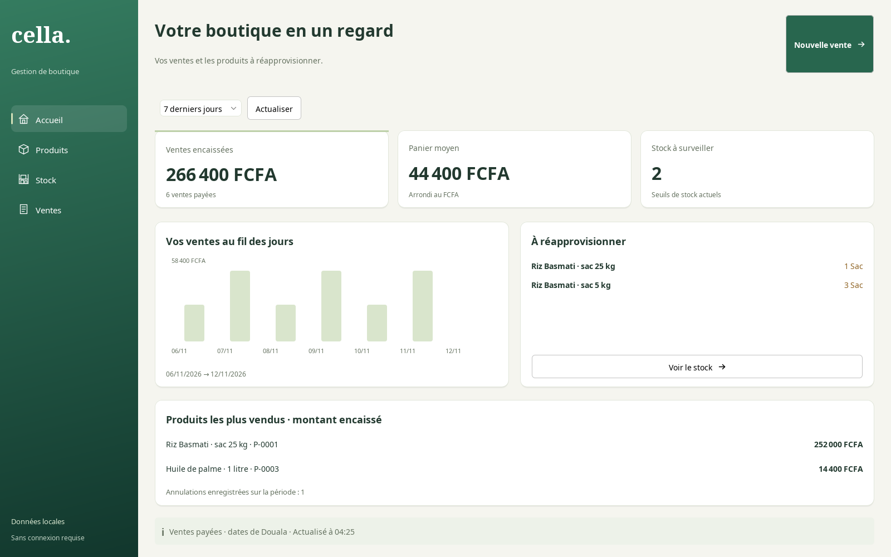
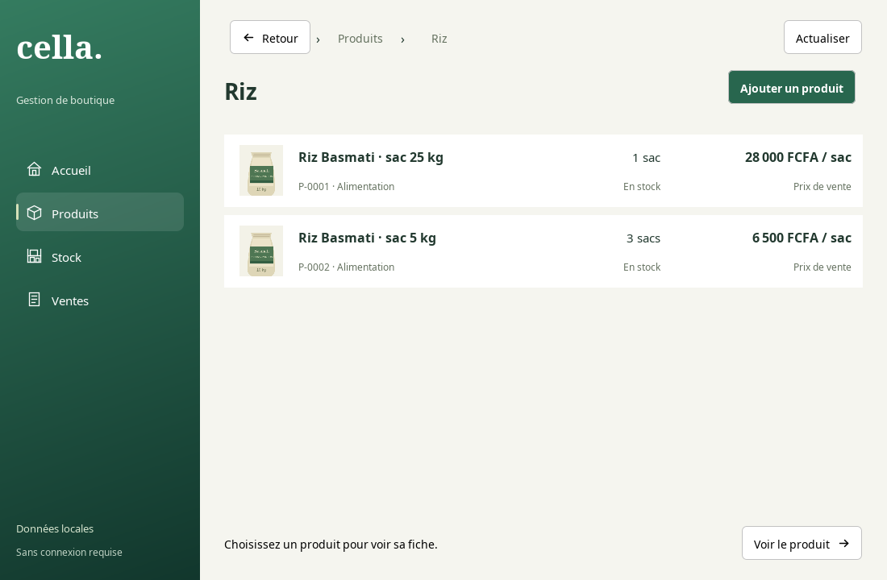

# Local overview and approved Atelier / Comptoir style

Patrick selected Atelier's warm green/ivory presentation with Comptoir's clear sans-serif typography
on 12 November 2026. The implementation uses the existing Swing/FlatLaf components and installed
sans-serif fonts. It adds no runtime downloads, schema changes or second UI framework.

## Local overview

**Accueil / Overview** is available in the labelled sidebar. Products remains the initial route, so an
existing cashier workflow does not suddenly start querying sales on launch. Opening Overview or
Refresh reads SaleService.listSaleStates and StockService.list off the Swing event thread.

- Today, last seven local calendar days and month-to-date use Africa/Douala boundaries.
- Paid revenue sums saved sale totals, excluding effective voided sales; later voids can therefore
  change historical paid-only figures. It is revenue, not cash-drawer balance or profit.
- Average receipt divides by distinct committed paid receipts with HALF_UP whole-FCFA display
  rounding. With no receipts it is unavailable, while a valid free sale has an average of zero.
- Cancellation activity counts void events by cancellation date, independently of sale date.
- Top products rank saved paid line subtotals for that same sale-date period. They use saved product
  names/references; no current catalogue prices, buying costs or unit-quantity sums are substituted.
- Low stock is current stock, not historical stock for the selected sales period. It uses each
  variant's stored quantity <= minimum, including zero, and never combines incompatible units.
- The chart covers the selected period, includes genuine zero-sale days and offers exact values by
  hover and accessible description. Pixel proportions alone use floating point; money sums do not.
- A loading/storage/overflow failure displays unavailable/error rather than zero. Stale background
  reads cannot overwrite a newer result. No write, automatic retry or payment occurs when browsing.

The overview uses complete service lists suitable for the current pilot. Large-shop indexed/paged
aggregation and a measured performance budget remain future work; do not claim benchmark targets
have been met. Custom ranges, comparison periods and inventory profit are not implemented here.

## Shared design

CatalogStyle owns the warm paper, forest green accents, rounded white surfaces and readable controls.
The sidebar expands to 248 logical pixels on larger windows and retains labelled navigation at
176px on the supported narrow window. Product photos/families and direct variant rows remain real
catalogue data. Prices and quantities align right; the working basket and recovery panels are retained.

Restore and backup/settings behavior remain Takou's responsibility. Coordinate shared ShellPanel,
style helpers, AppContext and translation changes before concurrent edits. The browser mockups under
`docs/design/visual-directions/` remain historical sample-data explorations, not a source of production
figures. Update styles through the shared helpers rather than per-screen UIManager overrides.

## Java screen previews

These are actual Swing component renders using a disposable SQLite sample shop, not live shop data.
They verify rendered layout; they do not replace native desktop keyboard, scaling or screen-reader checks.

