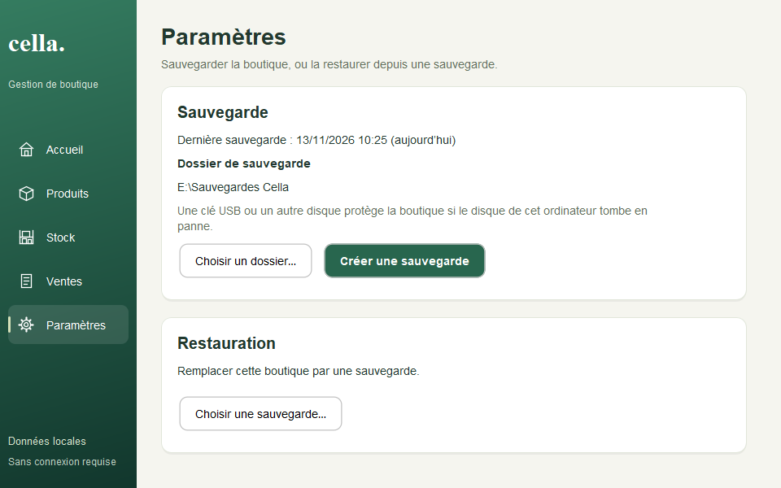
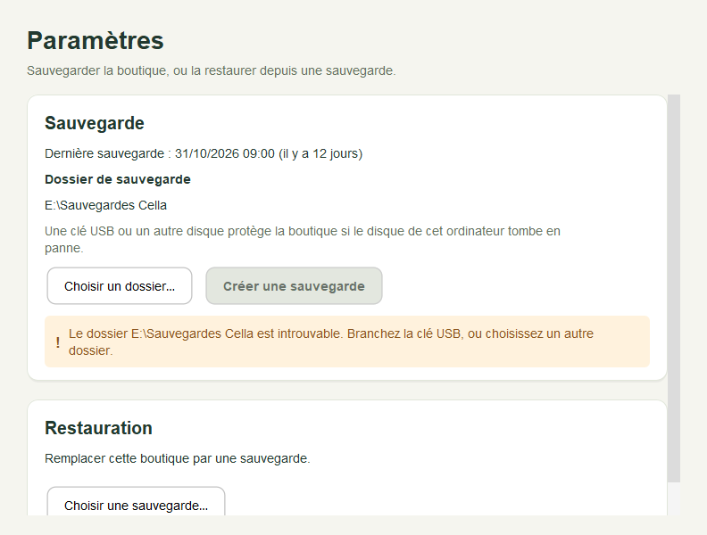
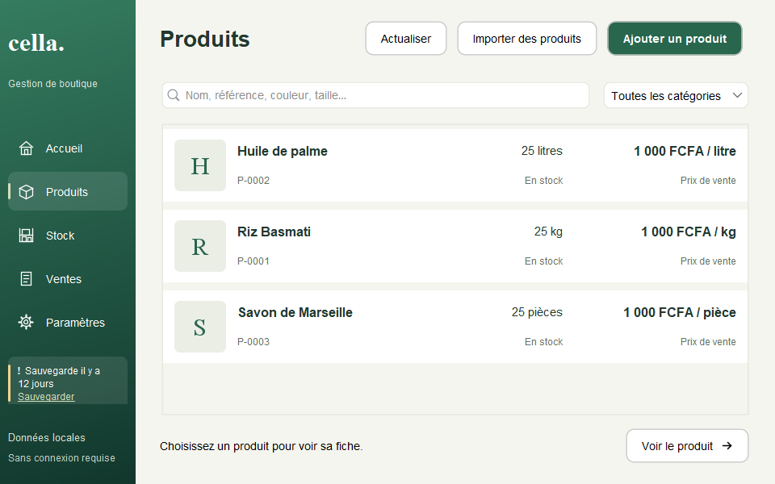
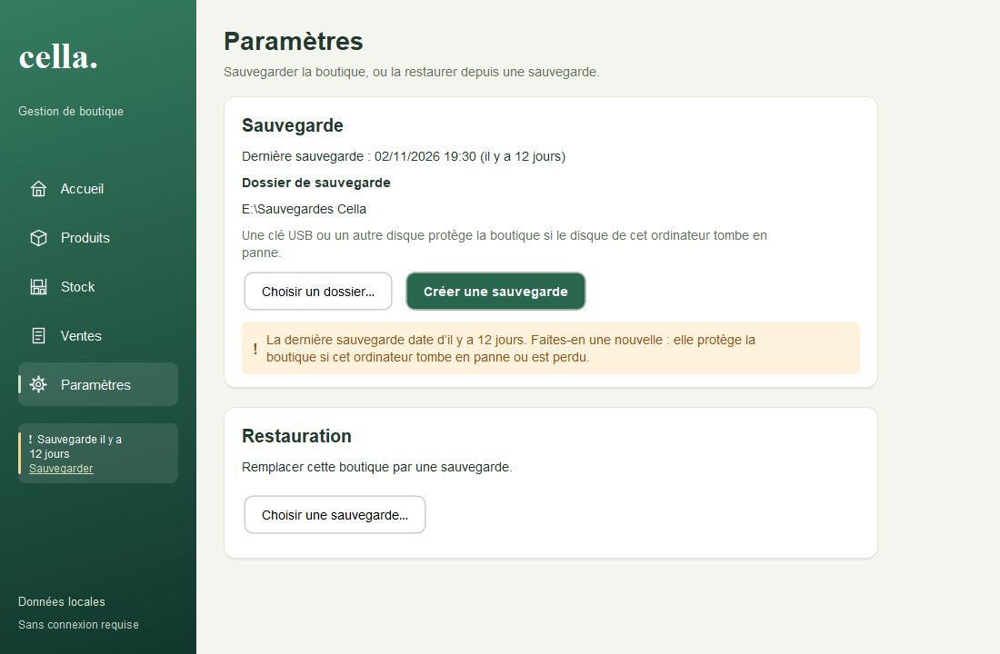
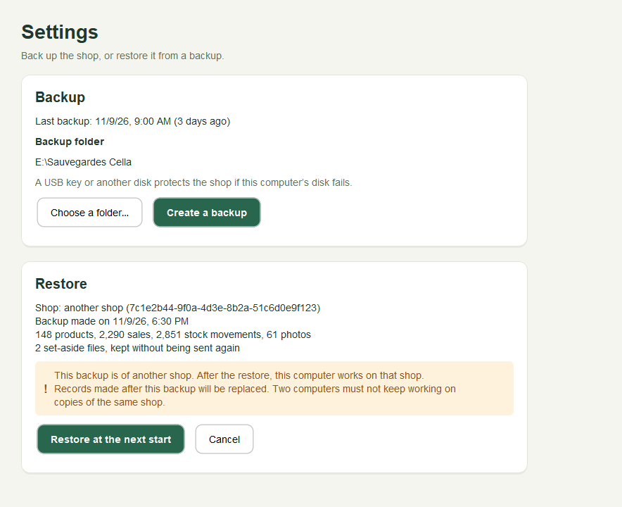
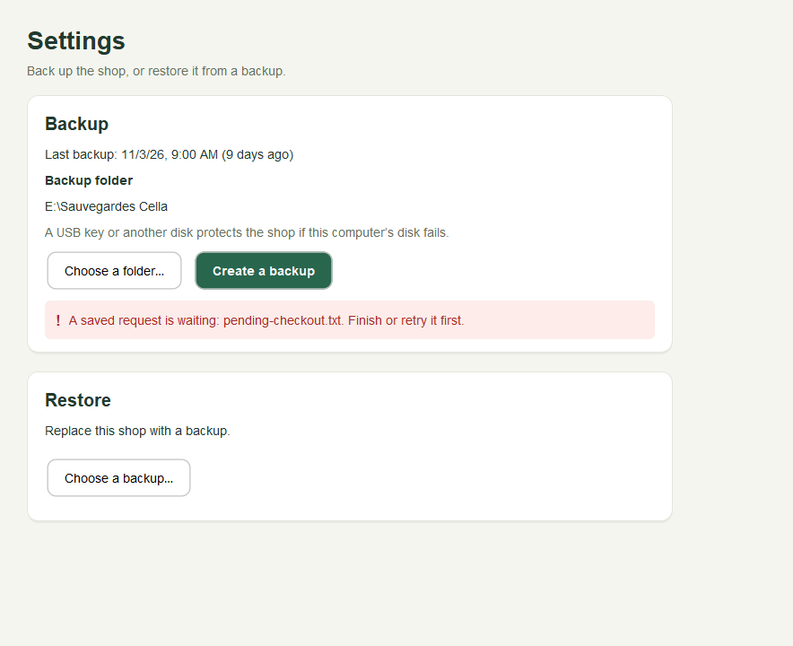
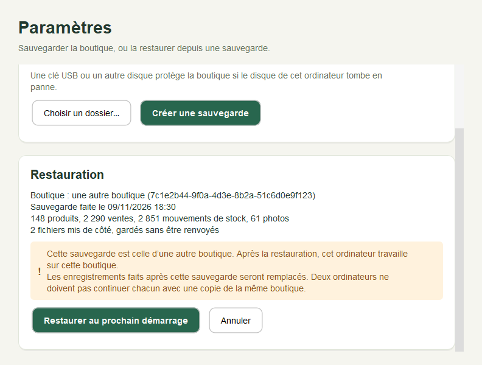
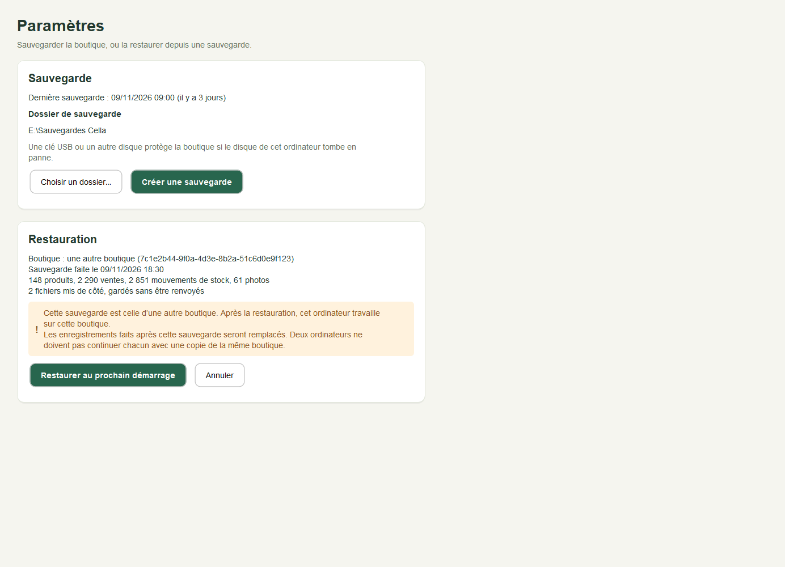

# The Settings screen: backup and restore (OFF-03c2)

`cm.sji.innova.desktop.settings.SettingsPanel` is the screen where the person backs up the shop or
restores it from a backup. It has two cards, **Backup** and **Restore**, over `BackupService`
(`BACKUP.md`) and `RestorePreparation` (`RESTORE.md`). The restore itself runs at the next start
(`RESTORE_RUN.md`).

The screen has its own package and its own French and English words (`settings_fr.properties`,
`settings_en.properties`). It uses `CatalogStyle` and `FeedbackStrip` as they are.

```java
SettingsPanel settings = new SettingsPanel(location, context, messages);
settings.reload();   // when the screen is shown: reads the last backup and any scheduled restore
```

Building the screen reads nothing. `reload()` reads in the background.

## In the app (OFF-03c3)

**Settings** (*Paramètres*) is the last entry in the sidebar, with a small gear icon (`SettingsIcon`,
in this package, so the shared style file does not change). Products is still the first screen.

- `ShellPanel` builds the screen the first time the entry is opened, on the shop that is open:
  `new SettingsPanel(context.location(), context, messages)`. Building it reads nothing.
- Every time the entry is opened, `ShellPanel` calls `reload()`. If a backup or restore action is
  still running, `reload()` reads nothing and returns that action.
- When the shop is opened again (Retry after an error), the old screen goes with the old shop.
- The backup and restore services use the folder membership Cella takes at start-up, so a backup
  waits for, or refuses, the shop's other work as described in `BACKUP.md`.



## Backup card

- **Last backup:** its date and age ("today", "yesterday", "3 days ago"), or "No backup yet."
- **Backup folder:** the folder Cella remembers (OFF-03c4a), else the last backup's folder, else "No
  folder chosen yet". *Choose a folder…* opens the system's folder dialog. The chosen folder is used at
  once and remembered for the next start, in the background. A hint says a USB key or another disk
  protects the shop if this computer's disk fails.
- **A folder that is not there** (a USB key not plugged in) is reported: "The folder *path* cannot be
  found. Plug in the USB key, or choose another folder." *Create a backup* waits until the folder is
  back (open Settings again) or another folder is chosen.
- **Create a backup** is disabled until a folder is chosen. While it runs, the screen says "Making the
  backup… Sales and stock wait until it is done." and every button is disabled. Then it says "Backup
  saved: *file name*", and the last-backup line changes to today.

### The remembered folder (OFF-03c4a)

Agreed with Patrick on 14 November: Cella remembers the chosen folder in the data folder.

- `BackupSettings` keeps it in `backup-settings.properties`, in the data folder, written in one step
  (a temporary file, then an atomic move). Other settings in that file are kept, for OFF-03c4's next parts.
- It is read and written through the folder's gate, so it waits while a backup or restore holds the
  folder, and never on the Swing event thread.
- It belongs to this computer, like the device ID: **a backup does not contain it, and a restore does
  not move it.**
- A file that cannot be read, or a folder that is not a full path, counts as nothing remembered: Settings
  offers the last backup's folder, or asks.
- If the folder cannot be remembered, it is still used now: "Cella uses this folder now, but could not
  remember it for the next start." and the reason.



### The reminder (OFF-03c4b)

Agreed with Patrick on 14 November: Cella reminds the shop after 7 days without a backup
(`BackupReminder.AFTER`).

- **When:** no backup recorded; a record that cannot be read (the safe side); or a last backup 7 days
  old or more. A computer clock set back does not cause a reminder.
- **In the sidebar, from start-up.** Under the navigation, a small box says "No backup yet" or "Last
  backup 12 days ago" (French: "Aucune sauvegarde", "Sauvegarde il y a 12 jours"), then "Back up now",
  which opens Settings.
  - In the sidebar it takes no room from the screens, so the smallest window, 960×600, keeps the
    screens' layout.
  - It is one button: the keyboard reaches it, and a screen reader reads both lines.
- **How it reads.** It reads the last backup in the background, through the folder's gate, with
  `BackupService.lastSuccess(location)`, which creates nothing. After a backup saved in Settings, it
  reads again and goes away.
- **In the Settings card:** "The last backup was 12 days ago. Make a new one: it protects the shop if
  this computer breaks or is lost.", or "Make a first backup: …". If the folder is not there, the card
  says that instead, because it must be fixed first.





## Restore card

| State | The card shows | Buttons |
| --- | --- | --- |
| Nothing chosen | "Replace this shop with a backup." | *Choose a backup…* |
| Checking | "Checking the backup… The shop is not changed." | all disabled |
| A backup chosen | Shop (this shop, or another shop with its ID), the backup's date, products, sales, stock movements, photos, and set-aside files if any. Warning: "Records made after this backup will be replaced. Two computers must not keep working on copies of the same shop." For another shop's backup, first: "This backup is of another shop. After the restore, this computer works on that shop." | *Restore at the next start*, *Cancel* |
| Scheduled | The same summary, and "A restore is scheduled. Close Cella and open it again to restore the backup made on *date*." | *Cancel the restore* |
| Scheduled, but its note cannot be read | "The scheduled restore cannot be read. Cancel it, then choose the backup again." | *Cancel the restore* |

- *Choose a backup…* calls `prepare`: the file is copied, checked and unpacked under `restore/`. The shop
  does not change.
- *Restore at the next start* calls `schedule`. *Cancel* calls `discard`, and *Cancel the restore* calls
  `cancelScheduled` (both say "Nothing was changed").
- Showing the screen again keeps a chosen backup that was not yet confirmed.

## Refusals, in the shop's words

| Refusal | What the screen says |
| --- | --- |
| Another Cella has the shop open | "Another Cella has this shop open. Close it, then try again." |
| A delivery, sale or import in progress | "A delivery, sale or import is in progress. Finish it, then try again." |
| The folder is busy (another maintenance) | "Cella is busy. Try again in a moment." |
| `REQUEST_PENDING` | "A saved request is waiting: *files*. Finish or retry it first." |
| `EVIDENCE_UNRESOLVED` | "Set-aside files are waiting for a decision: *files*." |
| `PHOTO_CHANGED` | "A photo is missing: *files*." |
| `DESTINATION_REFUSED` | "Choose a folder outside the shop's data folder, ideally on a USB key or another disk." |
| `CHECK_FAILED` while backing up | "The backup did not pass its check. Nothing was saved; try again." |
| `CHECK_FAILED` while choosing a backup | "This file is not a Cella backup that can be used." and the reason |
| `UPGRADE_FAILED`, `STAGED_CHECK_FAILED` | "This backup could not be brought up to date." / "The checked copy of this backup cannot be used.", and the reason |
| `ALREADY_SCHEDULED` | "A restore is already scheduled. Cancel it first." |
| `STAGING_CHANGED` | "The prepared restore changed. Choose the backup again." |
| `NOTE_DAMAGED` | "The scheduled restore cannot be read. Cancel it, then choose the backup again." |
| `FOLDER_UNSUPPORTED` | "This data folder cannot record a restore safely." |
| Anything else | "Could not finish." and the reason |

The next success removes an earlier refusal.

## Threads

- Every read and every action runs in a background worker, through the `SettingsPanel.Actions`
  interface. The screen only builds and updates components on the Swing event thread.
- While one piece of work runs, every button is disabled, and `reload()` reads nothing and returns that
  work.
- `ServiceActions`, the real `Actions`, makes `BackupService` and `RestorePreparation` fresh for each piece
  of work, in the worker. They pass through the folder's gate and maintenance (`DATA_FOLDER.md`), so a
  backup waits for, or refuses, the shop's other work as described in `BACKUP.md`.

## Style

- Two `CatalogStyle.surface` cards in a 720px column (`widthLimited`), in `scrollContent`, so small windows
  scroll.
- Titles at 28 and 20, text at 14, hints in `MUTED`. Messages in `FeedbackStrip` (info, success, warning,
  error).
- Long messages wrap at 600 screen pixels. The width is written in `pt`, because Swing's HTML counts one
  `px` as 1.3 pixels.
- Every message also sets its label's accessible name to the plain words, for screen readers and tests.
- The components are built in the panel. The work is in `Actions`. So the approved style can be applied
  later without touching backup or restore.









## Tests

**`SettingsPanelTest` (15).** Most tests give the screen fake actions that fail if they are called on the
Swing event thread. The last test uses the shop's own services on a disposable shop.

| Test | Checks |
| --- | --- |
| `buildingTheScreenReadsNothingAndReloadingShowsTheLastBackupAndItsFolder` | Nothing read until `reload()`; "3 days ago"; the last backup's folder offered |
| `withNoBackupYetAFolderMustBeChosenFirst` | "No backup yet", *Create a backup* disabled until a folder is chosen |
| `aBackupRunsOffTheSwingThreadWithEveryActionDisabledThenShowsItsResult` | The running message, every button disabled, `reload()` reads nothing meanwhile, then "Backup saved" and "today" |
| `aRefusedBackupSaysWhyInTheShopsWords` | Another Cella, an operation running, a saved request, set-aside files, a folder inside the data folder |
| `aBackupOfAnotherShopShowsWhatItHoldsAndBothWarningsThenIsScheduledThenCancelled` | The summary and both warnings, then scheduled, then cancelled |
| `aPreparedRestoreCanBeDiscardedAndABackupOfThisShopHasNoShopWarning` | One warning only; *Cancel* discards the copy |
| `aFileThatCannotBeRestoredIsRefusedWithItsReasonAndNothingIsScheduled` | `CHECK_FAILED` and `ALREADY_SCHEDULED` explained; the next success clears the refusal |
| `aScheduledRestoreThatCannotBeReadIsShownWithAWayToCancelIt` | A damaged note: the message and *Cancel the restore*; the last backup still shown |
| `reloadingKeepsAChosenBackupAndStillShowsTheLastBackupWhenTheRestoreStateCannotBeRead` | A read error is explained, the last backup is shown, the chosen backup stays |
| `everyWordIsInFrenchAndInEnglishWithTheSamePlaceholders` | Same keys, none blank, same number of `{0}`; the French screen |
| `theRememberedFolderIsOfferedFirstAndAChosenFolderIsRememberedOffTheSwingThread` | The remembered folder before the last backup's; a new choice is remembered |
| `aRememberedFolderThatIsNotThereIsReportedAndNoBackupStartsUntilItIsBack` | The warning, *Create a backup* disabled, then enabled when the folder is back |
| `aFolderThatCannotBeRememberedIsStillUsedNow` | The message, and the folder is used |
| `onTheShopsOwnServicesABackupIsMadeThenARestoreIsScheduledAndCancelled` | A real backup on a "USB key"; after a restart, a new screen offers the remembered folder; then that backup chosen, scheduled and cancelled |

**`BackupSettingsTest` (5, OFF-03c4a)** uses a disposable shop folder.

| Test | Checks |
| --- | --- |
| `nothingIsRememberedUntilAFolderIsChosenThenItIsKeptWithTheOtherSettings` | Nothing, then the folder as a full path after reading again; other settings kept; no temporary file left; a new choice replaces the old |
| `aSettingsFileThatCannotBeReadCountsAsNoFolder` | Blank, relative, bad escape, bad character, no folder line, a folder in the file's place |
| `readingAndRememberingWaitWhileABackupOrRestoreHoldsTheFolder` | Nothing written during maintenance; done after it |
| `neverOnTheSwingThread` | Both refuse the Swing thread |
| `theSettingsBelongToThisComputerABackupDoesNotHoldThemAndARestoreDoesNotMoveThem` | Not in a real backup; not in the restore's list of moved files |

**`BackupReminderTest` (4, OFF-03c4b).**

| Test | Checks |
| --- | --- |
| `dueWithNoBackupOrOneSevenDaysOldButNotBefore` | No backup, 7 days and 30 days: due; just under 7 days and a clock set back: not |
| `theCardWordsSayHowOldTheLastBackupIsInBothLanguages` | Nothing when recent; the first-backup and "12 days ago" sentences, in English and French |
| `theReminderReadsOffTheSwingThreadShowsWhenDueAndOpensSettings` | Building reads nothing; hidden until read; reads off the Swing thread; its words; it opens Settings; hidden after a recent backup |
| `inFrenchAndWhenTheRecordCannotBeReadItAsksForABackup` | An unreadable record: "Aucune sauvegarde"; the French words for an old backup |

`SettingsPanelTest` also has `theCardRemindsAfterSevenDaysWithoutABackupAndASavedBackupTellsTheWindow`
(15 tests in all): the card's reminder, the window told after a saved backup, and not after a refused one.

**`SettingsRouteTest` (3, OFF-03c3 and c4b)** opens the real `ShellPanel` on a disposable shop, with the
folder membership Cella takes at start-up.

| Test | Checks |
| --- | --- |
| `theSettingsEntryOpensTheScreenOnTheShopsOwnBackupAndRestoreServices` | Products first; the five entries in order; nothing built before Settings is opened; then "No backup yet". A real backup and a scheduled restore show when the entry is opened again, on the same screen; its *Cancel the restore* reaches the shop's restore service |
| `inFrenchTheEntryAndScreenAreFrenchAndOpeningTheShopAgainBuildsANewScreen` | The French entries and screen; after the shop is opened again, the old screen is gone and a new one is built |
| `theBackupReminderShowsInTheSidebarFromStartUpOpensSettingsAndGoesAfterABackup` | From start-up, in the sidebar, Products still first; it opens Settings with the remembered folder; a real backup from the screen makes it go away |

## Not yet

- **The start page's restore messages** (OFF-03b3b), on `ShellPanel`.
- **Keeping only the last backups, off unless the shop turns it on** (OFF-03c4c), as agreed with
  Patrick. A chosen backup that is never confirmed or cancelled keeps its copy in `restore/`.
- Deciding about set-aside files from this screen.
- The file dialogs are Swing's `JFileChooser`; the tests use a fake one.

## Review: destination changes while Settings is open

A chosen folder remains the active choice in this Settings window even if saving the preference
failed; reopening the route does not silently switch back to an older folder. The existing warning
still explains that the choice may not survive an application restart.

The production backup action uses `BackupService.createInExistingFolder`: it never recreates a
missing destination. If a chosen folder disappears after the screen loaded (or while waiting for
maintenance), the action fails, shows the missing-folder guidance and disables backup until the
folder is chosen or checked again. A lost folder does not create a new last-success record.
The general service `create` still supports explicitly creating a new destination for its callers.

These are path-availability checks, not proof that a USB device is mounted: a filesystem may leave
an existing mount directory behind. Actual USB removal/reconnection remains a manual acceptance check.
