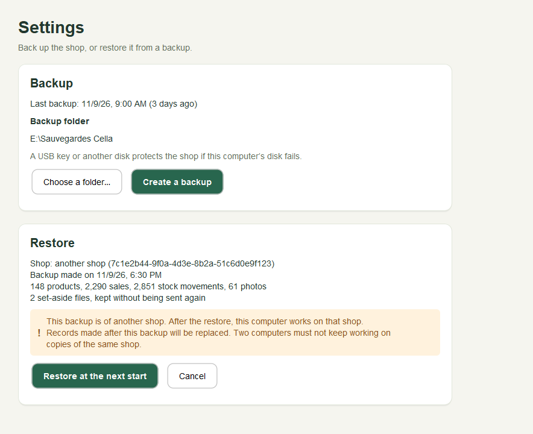
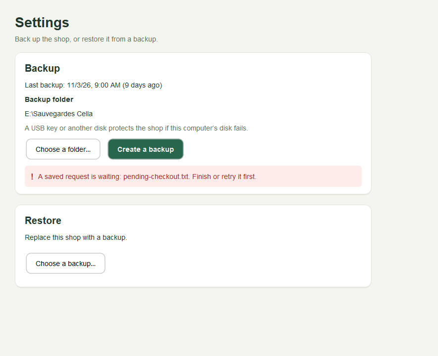
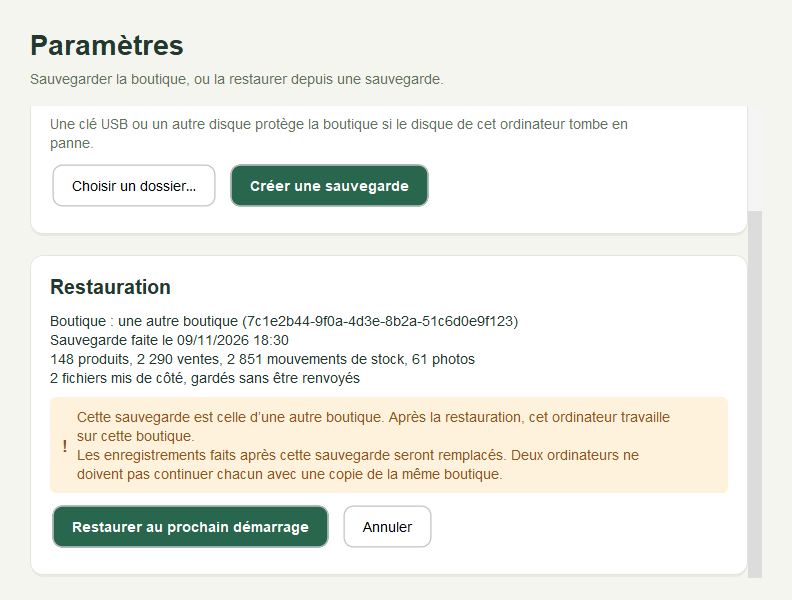
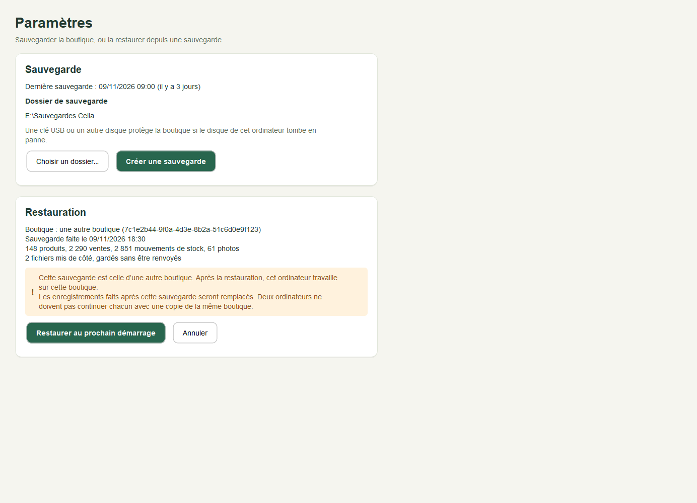

# The Settings screen: backup and restore (OFF-03c2)

`cm.sji.innova.desktop.settings.SettingsPanel` is the screen where the person backs up the shop or
restores it from a backup. It has two cards, **Backup** and **Restore**, over `BackupService`
(`BACKUP.md`) and `RestorePreparation` (`RESTORE.md`). The restore itself runs at the next start
(`RESTORE_RUN.md`).

**It is not in the sidebar yet.** Its entry changes `ShellPanel`, which waits for Patrick's agreement
(OFF-03c3). The screen has its own package and its own French and English words
(`settings_fr.properties`, `settings_en.properties`). It uses `CatalogStyle` and `FeedbackStrip` as they
are; no shared file is changed.

```java
SettingsPanel settings = new SettingsPanel(location, context, messages);
settings.reload();   // when the screen is shown: reads the last backup and any scheduled restore
```

Building the screen reads nothing. `reload()` reads in the background.

## Backup card

- **Last backup:** its date and age ("today", "yesterday", "3 days ago"), or "No backup yet."
- **Backup folder:** the last backup's folder, or "No folder chosen yet". *Choose a folder…* opens the
  system's folder dialog. A hint says a USB key or another disk protects the shop if this computer's
  disk fails.
- **Create a backup** is disabled until a folder is chosen. While it runs, the screen says "Making the
  backup… Sales and stock wait until it is done." and every button is disabled. Then it says "Backup
  saved: *file name*", and the last-backup line changes to today.

## Restore card

| State | The card shows | Buttons |
| --- | --- | --- |
| Nothing chosen | "Replace this shop with a backup." | *Choose a backup…* |
| Checking | "Checking the backup… The shop is not changed." | all disabled |
| A backup chosen | Shop (this shop, or another shop with its ID), the backup's date, products, sales, stock movements, photos, and set-aside files if any. Warning: "Records made after this backup will be replaced. Two computers must not keep working on copies of the same shop." For another shop's backup, first: "This backup is of another shop. After the restore, this computer works on that shop." | *Restore at the next start*, *Cancel* |
| Scheduled | The same summary, and "A restore is scheduled. Close Cella and open it again to restore the backup made on *date*." | *Cancel the restore* |
| Scheduled, but its note cannot be read | "The scheduled restore cannot be read. Cancel it, then choose the backup again." | *Cancel the restore* |

- *Choose a backup…* calls `prepare`: the file is copied, checked and unpacked under `restore/`. The shop
  does not change.
- *Restore at the next start* calls `schedule`. *Cancel* calls `discard`, and *Cancel the restore* calls
  `cancelScheduled` (both say "Nothing was changed").
- Showing the screen again keeps a chosen backup that was not yet confirmed.

## Refusals, in the shop's words

| Refusal | What the screen says |
| --- | --- |
| Another Cella has the shop open | "Another Cella has this shop open. Close it, then try again." |
| A delivery, sale or import in progress | "A delivery, sale or import is in progress. Finish it, then try again." |
| The folder is busy (another maintenance) | "Cella is busy. Try again in a moment." |
| `REQUEST_PENDING` | "A saved request is waiting: *files*. Finish or retry it first." |
| `EVIDENCE_UNRESOLVED` | "Set-aside files are waiting for a decision: *files*." |
| `PHOTO_CHANGED` | "A photo is missing: *files*." |
| `DESTINATION_REFUSED` | "Choose a folder outside the shop's data folder, ideally on a USB key or another disk." |
| `CHECK_FAILED` while backing up | "The backup did not pass its check. Nothing was saved; try again." |
| `CHECK_FAILED` while choosing a backup | "This file is not a Cella backup that can be used." and the reason |
| `UPGRADE_FAILED`, `STAGED_CHECK_FAILED` | "This backup could not be brought up to date." / "The checked copy of this backup cannot be used.", and the reason |
| `ALREADY_SCHEDULED` | "A restore is already scheduled. Cancel it first." |
| `STAGING_CHANGED` | "The prepared restore changed. Choose the backup again." |
| `NOTE_DAMAGED` | "The scheduled restore cannot be read. Cancel it, then choose the backup again." |
| `FOLDER_UNSUPPORTED` | "This data folder cannot record a restore safely." |
| Anything else | "Could not finish." and the reason |

The next success removes an earlier refusal.

## Threads

- Every read and every action runs in a background worker, through the `SettingsPanel.Actions`
  interface. The screen only builds and updates components on the Swing event thread.
- While one piece of work runs, every button is disabled, and `reload()` reads nothing and returns that
  work.
- `ServiceActions`, the real `Actions`, makes `BackupService` and `RestorePreparation` fresh for each piece
  of work, in the worker. They pass through the folder's gate and maintenance (`DATA_FOLDER.md`), so a
  backup waits for, or refuses, the shop's other work as described in `BACKUP.md`.

## Style

- Two `CatalogStyle.surface` cards in a 720px column (`widthLimited`), in `scrollContent`, so small windows
  scroll.
- Titles at 28 and 20, text at 14, hints in `MUTED`. Messages in `FeedbackStrip` (info, success, warning,
  error).
- Long messages wrap at 600 screen pixels. The width is written in `pt`, because Swing's HTML counts one
  `px` as 1.3 pixels.
- Every message also sets its label's accessible name to the plain words, for screen readers and tests.
- The components are built in the panel. The work is in `Actions`. So the approved style can be applied
  later without touching backup or restore.









## Tests

**`SettingsPanelTest` (11).** Most tests give the screen fake actions that fail if they are called on the
Swing event thread. The last test uses the shop's own services on a disposable shop.

| Test | Checks |
| --- | --- |
| `buildingTheScreenReadsNothingAndReloadingShowsTheLastBackupAndItsFolder` | Nothing read until `reload()`; "3 days ago"; the last backup's folder offered |
| `withNoBackupYetAFolderMustBeChosenFirst` | "No backup yet", *Create a backup* disabled until a folder is chosen |
| `aBackupRunsOffTheSwingThreadWithEveryActionDisabledThenShowsItsResult` | The running message, every button disabled, `reload()` reads nothing meanwhile, then "Backup saved" and "today" |
| `aRefusedBackupSaysWhyInTheShopsWords` | Another Cella, an operation running, a saved request, set-aside files, a folder inside the data folder |
| `aBackupOfAnotherShopShowsWhatItHoldsAndBothWarningsThenIsScheduledThenCancelled` | The summary and both warnings, then scheduled, then cancelled |
| `aPreparedRestoreCanBeDiscardedAndABackupOfThisShopHasNoShopWarning` | One warning only; *Cancel* discards the copy |
| `aFileThatCannotBeRestoredIsRefusedWithItsReasonAndNothingIsScheduled` | `CHECK_FAILED` and `ALREADY_SCHEDULED` explained; the next success clears the refusal |
| `aScheduledRestoreThatCannotBeReadIsShownWithAWayToCancelIt` | A damaged note: the message and *Cancel the restore*; the last backup still shown |
| `reloadingKeepsAChosenBackupAndStillShowsTheLastBackupWhenTheRestoreStateCannotBeRead` | A read error is explained, the last backup is shown, the chosen backup stays |
| `everyWordIsInFrenchAndInEnglishWithTheSamePlaceholders` | Same keys, none blank, same number of `{0}`; the French screen |
| `onTheShopsOwnServicesABackupIsMadeThenARestoreIsScheduledAndCancelled` | A real backup on a "USB key", then that backup chosen, scheduled and cancelled |

## Not yet

- **The sidebar entry** (OFF-03c3), after Patrick's agreement on `ShellPanel`.
- **The start page's restore messages** (OFF-03b3b), also on `ShellPanel`.
- **A reminder to back up, how many backups to keep, and removing old `restore/` folders** (OFF-03c4),
  with Patrick's defaults. A chosen backup that is never confirmed or cancelled keeps its copy in
  `restore/` until then.
- Deciding about set-aside files from this screen.
- The file dialogs are Swing's `JFileChooser`; the tests use a fake one.
