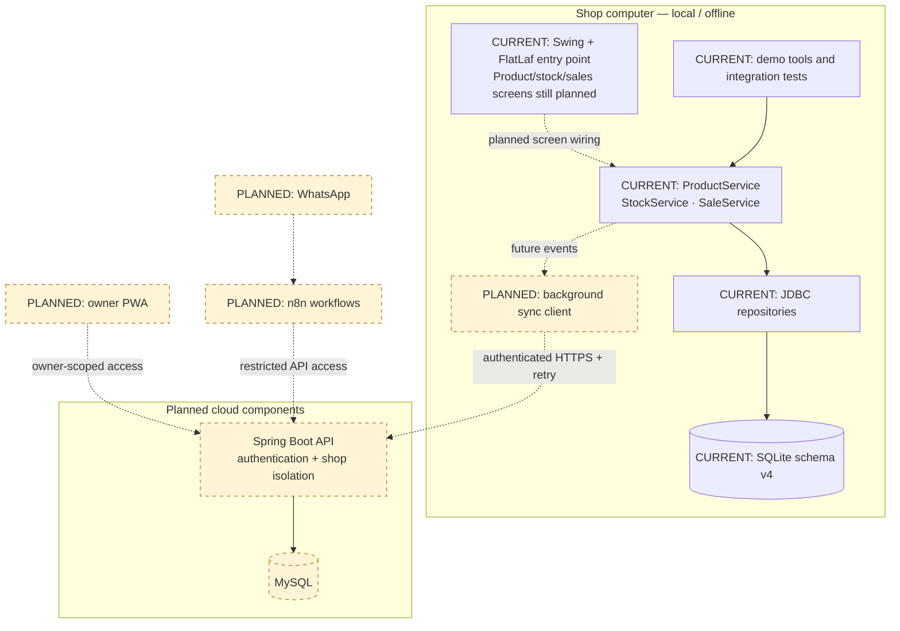

# Application architecture

**Scope:** Implemented foundation + clearly marked planned components. Snapshot: main `5ff771a`, 29 October 2026.

Boxes marked CURRENT are in the repository. Dashed connections describe future integration, not running services.

The desktop entry point exists, but it is still a placeholder window. Core services execute locally; they are not separate network servers. SQLite JDBC is bundled with the application. MySQL is a future cloud store, not a replacement for the offline database.

[SVG image](images/01-architecture.svg) · [Editable Mermaid source](sources/01-architecture.mmd) · [Diagram index](README.md)
