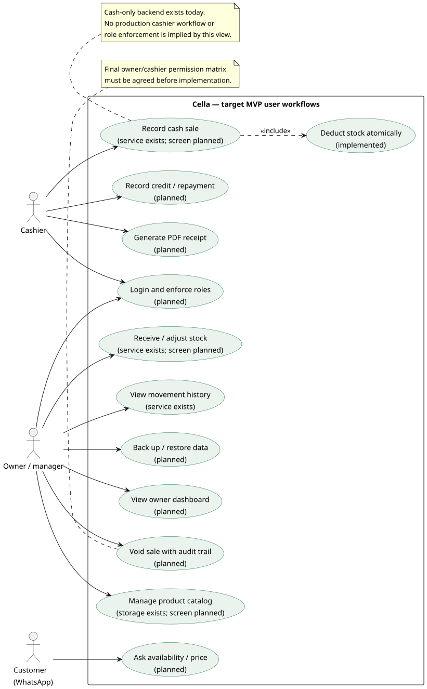

# UML use-case diagram

**Scope:** target MVP actors/workflows with current backend status labelled.
Snapshot: main `5ff771a`, 29 October 2026.

A use case describes what a person wants to accomplish, rather than which Java
method runs. The person icon is an actor; the oval is a goal. The system boundary
shows which goals belong to Cella. An `include` relationship means the included
behavior is required by that use case.

This is genuine UML use-case notation, supplied as editable PlantUML because
GitHub Mermaid has no native use-case-diagram type. GitHub can display the SVG
without plugins. Owner/cashier assignments are proposed workflow responsibilities,
not proof that permissions are implemented. Final permission rules need team
agreement. Customer WhatsApp access is restricted to availability/price; owner
WhatsApp is a later Should extension and is not required by this diagram.

[PlantUML source](sources/02-use-cases.puml) · [SVG image](images/02-use-cases.svg) · [Diagram index](README.md)
