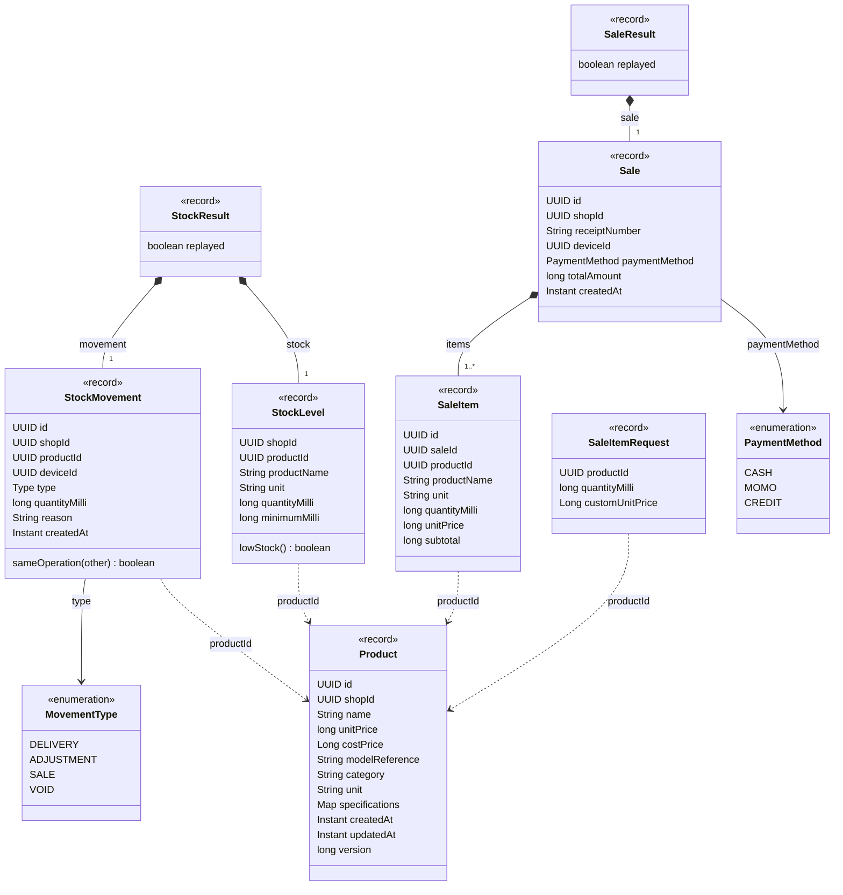

# UML domain class diagram

**Scope:** Current Java records (selected fields). Snapshot: main `5ff771a`, 29 October 2026.

A class/record describes information the application passes around. Composition means an object contains other objects; it does not automatically imply a database foreign key.

`MovementType` is the nested Java enum `StockMovement.Type`; the diagram gives it a unique display name. `unitPrice` means **selling price** and nullable `costPrice` means **buying price**. Cash checkout is implemented; enum values MOMO/CREDIT and movement type VOID do not establish completed payment/void services. Product specifications are a Map in Java and a separate table in SQLite. Cached stock is exposed by StockLevel, not by the Product record. Quantities are thousandths; prices are whole FCFA.

[SVG image](images/03-domain-classes.svg) · [Editable Mermaid source](sources/03-domain-classes.mmd) · [Diagram index](README.md)
