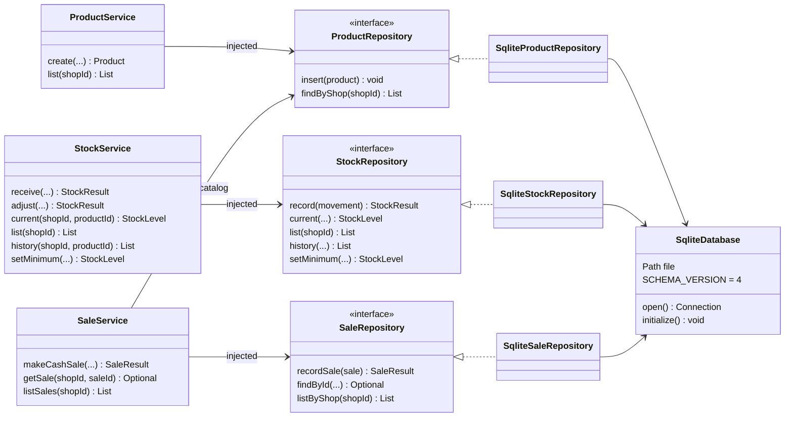

# UML service and repository class diagram

**Scope:** Current code; signatures shortened for readability. Snapshot: main `5ff771a`, 29 October 2026.

Services are the entry points for business operations. Repository interfaces describe storage operations; the SQLite classes implement them.

Cash sales reduce stock inside SqliteSaleRepository’s own transaction. They do **not** commit a sale and then call StockService as a separate operation. Desktop code should inject these services and run database work off Swing’s Event Dispatch Thread. Full signatures are in the source and [stock](../backend/STOCK.md)/[sales](../backend/SALES.md) guides.

[SVG image](images/04-services-repositories.svg) · [Editable Mermaid source](sources/04-services-repositories.mmd) · [Diagram index](README.md)
