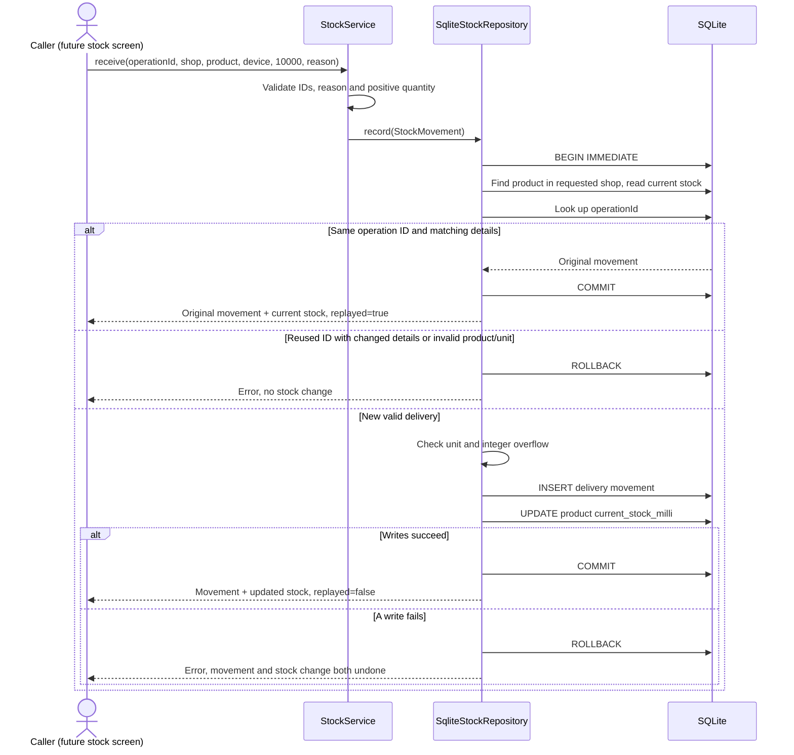

# UML sequence: receive stock

**Scope:** Current receipt behavior. Snapshot: main `5ff771a`, 29 October 2026.

This shows the order of messages when receiving 10 pieces. The caller can currently be a demo/test; the stock screen is still planned.

10000 stored units = 10 pieces. The operation ID must be reused only for a retry of the same request. Replay returns **current** stock, which may include later movements. Validation is shared between the record/service and repository; errors can occur before the transaction starts. Shop filtering is not yet user authentication. Return arrows to Caller are simplified: results propagate through the service.

[SVG image](images/05-stock-sequence.svg) · [Editable Mermaid source](sources/05-stock-sequence.mmd) · [Diagram index](README.md)
