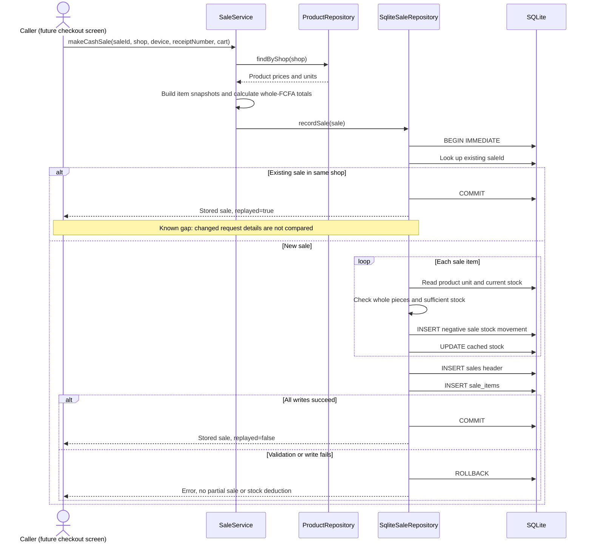

# UML sequence: offline cash sale

**Scope:** Current cash checkout, including known limitations. Snapshot: main `5ff771a`, 29 October 2026.

This sequence follows the implemented transaction order. It does not invent a sale-event table or a printed/PDF receipt feature.

The implementation truncates each fractional line subtotal using integer division; an explicit rounding policy remains to be agreed. A changed retry can return the old sale without rejecting changed details. Product lookup/calculation happens before the write transaction. The diagram’s failure branch summarizes errors anywhere inside the transaction; execution stops at the first failure. A receipt **number** is stored, but receipt document generation is not implemented.

[SVG image](images/06-sale-sequence.svg) · [Editable Mermaid source](sources/06-sale-sequence.mmd) · [Diagram index](README.md)
