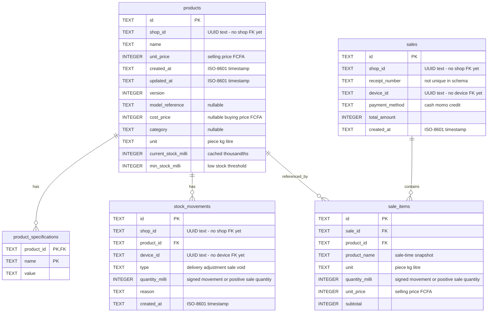

# Database ER diagram: actual SQLite schema v4

**Scope:** Implemented physical database. Snapshot: main `5ff771a`, 29 October 2026.

Generated against an empty database initialized by the Java migration runner. Every table, column, primary key and drawn foreign key below exists in schema v4.

**How to read it:** one product can have zero or many specification rows, stock movements, or sale items. Every such child row references one product. A sale can have zero or many items at the **database constraint** level; Java’s Sale constructor requires at least one. `product_specifications` has a composite primary key `(product_id, name)`.

**Important boundaries:**

- There are exactly five application tables. No shops, devices, users, customers, debts or sale_events table exists yet. `shop_id` and `device_id` are UUID text fields, not foreign keys to hidden tables.
- There is **no sale_id foreign key in stock_movements**. Sales currently identify a movement using its reason text; the diagram does not invent a durable relational link.
- UUIDs and timestamps are stored as TEXT; prices/quantities are INTEGER. `cost_price`, `model_reference` and `category` are nullable. `unit_price` is selling price, not buying price.
- Delete rules: product specifications CASCADE; sale-item references to products/sales RESTRICT; stock movement product FK uses SQLite’s default NO ACTION. Foreign keys are enabled by each application connection.
- Update/delete triggers make stock_movements append-only. Sales and sale_items do **not** currently have equivalent append-only triggers. Receipt numbers are not UNIQUE.
- Current-stock/minimum default to 0; unit defaults to piece. Quantity thousandths and whole-FCFA price rules apply. Some type/range rules are CHECK constraints and some are service validations.

See the [exact SQL snapshot](database/schema-v4.sql) for constraints, indexes and triggers. It is documentation for a fresh empty database, not a replacement for migration code.

[SVG image](images/07-database-current.svg) · [Editable Mermaid source](sources/07-database-current.mmd) · [Diagram index](README.md)
