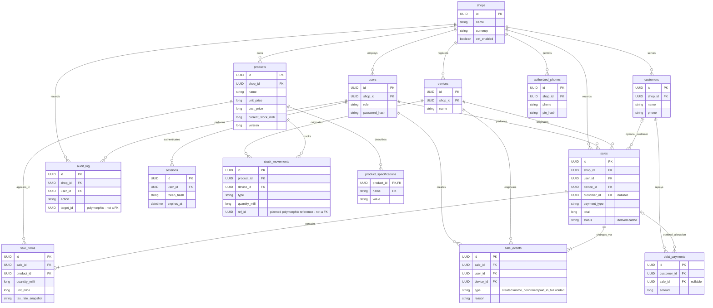

# Database ER diagram: proposed full MVP

**Scope:** PLANNED logical model, not an implemented schema or migration. Snapshot: main `5ff771a`, 29 October 2026.

This conceptual view extends the current product/specification model with the future features in the revised plan. Fields are selected examples, not complete SQL definitions. Review the design with Emmanuel before implementation.

This is a **logical target**: UUID/datetime types indicate meaning, not the SQLite TEXT representation. Tenant/shop identifiers, timestamps and catalog versions are omitted from some boxes for readability; they must be specified consistently before SQL is written. Optional tax uses exact agreed arithmetic, not floating-point assumptions.

Transactional records (sales, items, sale events, movements, repayments, audit) are intended to be append-only; state changes become events. Catalog changes require explicit conflict/version rules. Keep future sync delivery status outside immutable business records. Relationships do not by themselves enforce same-shop consistency: composite keys/service checks and an authentication design are still needed.

A polymorphic `ref_id` is not an enforced foreign key. Repayment allocation, cancellation rules, device sync ordering and the physical local/cloud schemas need further design. Parent/child product-variant grouping is not included: each sellable combination remains a product. Optional cash reconciliation and other Should/Could features are deliberately outside this Must-model overview.

[SVG image](images/08-database-target.svg) · [Editable Mermaid source](sources/08-database-target.mmd) · [Diagram index](README.md)
