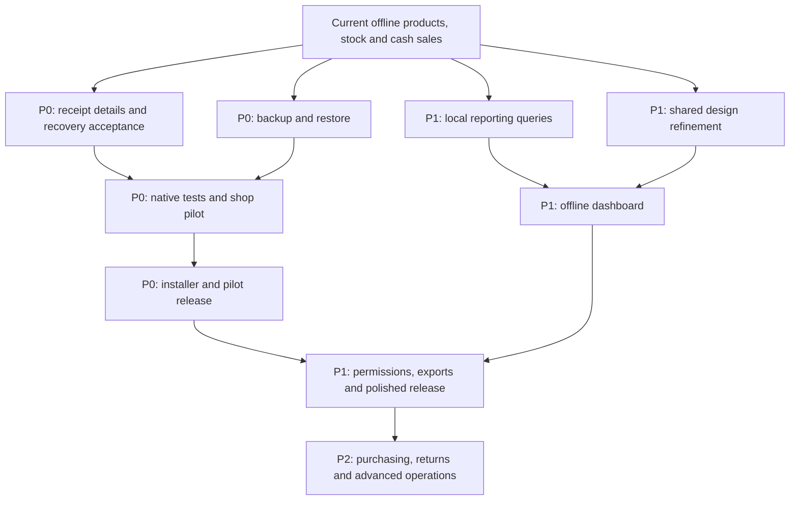

# Cella — offline completion and product-quality roadmap

Updated: 8 November 2026. Baseline: merged main commit `ffe2700` (PR #40).

**Goal:** a beautiful, easy-to-use desktop application that a shop secretary can operate without internet, with dependable records, recovery, useful statistics, and a straightforward installation.

This is a planning document, not a claim that the tasks below are implemented. Check boxes mean accepted work, not code merely submitted. Owners are proposed for coordination; this document does not replace or silently expand the current individual briefs in `docs/team/`. Patrick confirms assignments before simultaneous work starts.

Being competitive requires reliable shop trials and comparison with real alternatives. “Best on the market” is the ambition; this roadmap defines measurable improvements rather than promising that result.

## 1. Where we are now

| Area | Evidence in the baseline | Remaining work |
| --- | --- | --- |
| Products | Local catalogue, families/variants, references, search, CSV workflow and local photo support | Review editing/archive needs, simplify daily use, complete photo/import acceptance checks |
| Stock | Receipts, durable recovery, signed corrections, minimum thresholds and movement history | More restart/failure/concurrency acceptance and clearer everyday workflows |
| Sales | Cash basket, atomic stock deduction, durable checkout recovery, saved sales and history filters | Receipt details, desktop void workflow, printing/export and cashier acceptance |
| Sale voids | Audited full cash-sale void exists in core | Permission-controlled desktop flow and its recovery tests; partial returns remain separate future work |
| Design | Green gradient sidebar, shared controls, cards, badges, responsive forms, FR/EN text | Larger refined navigation, consistent typography, dashboard, accessibility and visual review |
| Build | Java 21; PR #40 Windows/Linux checks passed; 295 tests in the accepted baseline | Native interaction, restart/restore drills, installers and performance checks |
| Backups, users, dashboard | Not accepted as complete desktop workflows | Design, implement and verify them |

A passing build is not a substitute for opening the app and completing a shop transaction. Backend support does not mean a usable screen exists.

## 2. Priorities and release gates

- **P0 — safe pilot:** complete receipts, protect/recover records, validate the money/stock workflows, provide an installer and practical instructions. Required before relying on Cella for real shop records.
- **P1 — polished offline release:** refined interface, offline dashboard, permissions, exports, faster stock work, supportable installation and measured performance. Required before calling the product broadly ready for ordinary shop staff.
- **P2 — competitive extensions:** purchasing, suppliers, customer accounts, returns, advanced analysis and hardware integrations. Deliver in small tested increments after the pilot.

Offline release does not depend on a cloud account, web API, WhatsApp, online fonts, or an internet connection. Cloud synchronization and mobile access need separate designs and are outside this checklist.

## 3. P0 — complete the everyday transaction loop

### OFF-01 · Historical receipt details — proposed owner: Charles

- [ ] Open a receipt from history by double-click, Enter, or a clear labelled action.
- [ ] Show receipt reference, local date/time, status, saved product names/references, quantities, charged unit prices and saved totals.
- [ ] Show an understandable cancelled state and saved cancellation information when available.
- [ ] Return to the same search, dates, status filter and selected receipt; returning to checkout preserves the basket and pending request.
- [ ] Keep the screen read-only. Never replace historical prices with current catalogue prices or show buying prices to a cashier.

**Accepted when:** sell two products, change a current catalogue price later, reopen the historical receipt, and still see exactly what was charged. Opening history/details must create no stock or sale writes.

### OFF-02 · Recovery and integrity acceptance — proposed owners: Willy + Emmanuel; Pascal verifies

- [ ] Test receipt, stock correction, cash sale and CSV recovery with a request saved before submission.
- [ ] Simulate “database committed, response lost”; restart and retry the original UUID. Verify exactly one committed operation.
- [ ] Test failure before commit, pending-file write failure, cleanup failure after confirmation, and no automatic resubmission on startup.
- [ ] Test corrupt files, wrong shop/device, changed product/unit and an unavailable data directory. Preserve recovery evidence and explain the next action.
- [ ] Verify temporary file access failures can recover on Refresh without permanently disabling the screen.
- [ ] Test two windows and two JVM processes using the same local folder; overlapping operations must not overwrite or clear each other's requests.
- [ ] Verify known rejected operations return to editable input, while uncertain outcomes retain the original immutable request.
- [ ] Run controlled forced-close/restart checks with disposable data on Windows and Linux. Do not use live shop records for destructive drills.

**Accepted when:** each scenario records starting balance, operation UUID, final balance, movement/sale count and recovery-file state. No duplicate sale, duplicate delivery, negative balance or silently discarded uncertain operation.

### OFF-03 · Backup and restore — proposed owner: Emmanuel; Patrick tests usability

- [ ] Add Settings actions for “Create backup” and “Restore backup”, with destination, progress, result and last successful backup time.
- [ ] Define a versioned backup format containing a consistent database snapshot, local product photos and required shop/configuration metadata; include a manifest and checksums.
- [ ] Decide how pending receipts, corrections, checkout and imports are captured/reconciled. Either safely include a consistent recovery snapshot or block backup with actionable instructions while writes are unresolved.
- [ ] Coordinate backup with all local application writers. Do not copy only an actively used `.db` file; use a supported SQLite snapshot mechanism or a documented coordinated shutdown procedure.
- [ ] Offer reminders and retention settings. A backup on the same disk is not protection from disk failure; allow a USB/external destination.
- [ ] Validate archive paths, format/version, checksums and database integrity before restore. Extract to staging, reject unsafe archive paths, and retain the current installation's data until replacement succeeds.
- [ ] Require all windows/processes to stop writing during restore. Show which shop and snapshot date will be restored; create a pre-restore backup.
- [ ] Preserve shop and operation identity. Define device-identity handling for relocation versus a second workstation so restored recovery requests cannot be duplicated across active copies.
- [ ] Explain that restore returns records to the snapshot date, then safely reconcile included pending requests. Do not promise to recover sales made after that snapshot.

**Accepted when:** back up a shop with photos and transactions, restore into an isolated installation, and match products, sale totals, balances, photos and recovery behavior. Corrupt/incompatible backups must leave existing data intact.

### OFF-04 · Catalogue and stock completion review — proposed owners: Patrick + Willy

- [ ] Audit which create/edit/archive actions are actually reachable, then implement missing essential actions without duplicating existing services.
- [ ] Allow safe correction of product name, category, family, specifications, selling price and photo, with clear save/cancel behavior.
- [ ] Archive products instead of deleting those referenced by sales or movements; define whether archived products remain recoverable and searchable in history.
- [ ] Preserve immutable UUIDs/references and historical sale snapshots. Do not silently change a transacted product's canonical unit; define an explicit replacement/conversion workflow if needed.
- [ ] Make similar variants distinguishable by family, reference, weight/size/color and photo. Example: Riz → Basmati 5 kg / Basmati 25 kg / other brands.
- [ ] Keep category user-defined and optional; keep advanced fields optional. Put opening quantities/deliveries in Stock, not an unrelated product field that bypasses movements.
- [ ] Validate CSV row errors, preview, duplicate policy, accents/decimal comma and safe retry. Existing photo workflows must handle removal, invalid files and missing images gracefully.
- [ ] Confirm low-stock thresholds persist and use quantity <= minimum, including zero; never add bags, pieces, kg and litres as one quantity.

**Accepted when:** a secretary can identify the correct rice variant, receive it, set its threshold, correct a counted discrepancy with a reason, and reopen the app without losing the result.

### OFF-05 · Cashier verification — proposed owners: Charles + Pascal

- [ ] Test the full flow without internet: add product → receive 10 → sell 2 → restart → stock 8 and one saved sale.
- [ ] Validate empty basket, unavailable products, fractional restrictions, overflow, duplicate clicks, insufficient stock and a sale rejected after stock changed in another window.
- [ ] Add or finish cash tendered/change display if absent. Distinguish sale revenue from cash received and change returned; never label revenue as cash-drawer balance.
- [ ] Verify keyboard operation and that confirmation shows the actual charged total.
- [ ] Keep failed/loading/pending states distinguishable from a valid zero or empty result.

**Accepted when:** complete a written set of cashier scenarios on Windows/Linux; compare the recorded stock and money with expected values to the FCFA.

### OFF-06 · Installation and pilot delivery — proposed owners: Patrick + Emmanuel

- [ ] Produce a versioned Windows installer and a documented Linux package/launcher with a bundled compatible Java runtime; ordinary users should not need Maven or Java setup.
- [ ] Set app name, icon, version, data location and desktop shortcut. Upgrade without deleting or silently moving shop data.
- [ ] Test install, launch, upgrade, uninstall/data-retention behavior, failed migration and recovery from a pre-upgrade backup.
- [ ] Make first launch explain the shop name, language and data location. Mark the temporary development identity clearly until a proper shop setup flow replaces it.
- [ ] Write a short FR/EN illustrated guide for products, stock, sales, backups and requesting help.
- [ ] Run a small pilot using a copy of the brother's spreadsheet. Agree on CSV mapping and verify sample records before importing everything.
- [ ] Keep a discrepancy log; reconcile opening stock and daily sales with the shop's existing records before treating Cella as the official record.

**Accepted when:** someone outside the development team can install the app and complete the basic workflow following the guide, with internet disconnected.

## 4. P1 — major application redesign and visual quality

### OFF-07 · Full visual and interaction redesign — proposed owner: Patrick; Charles integrates

- [ ] Preserve the approved green palette and gradient; refine the main area to match it rather than replacing it with another visual theme.
- [ ] Prototype an expanded sidebar around 220–240 logical pixels at 1100px+ windows, with a compact/collapsible layout at 960px. Choose the final width using real previews, not a fixed width that crowds checkout.
- [ ] Use a clear order: Dashboard, Products, Stock, Sales, Reports, Settings. Place shop identity and backup/offline information where useful, without inventing unsupported features or fake status indicators.
- [ ] Give navigation generous spacing, distinct consistent outline icons, readable labels, a confident selected state and visible keyboard focus. A collapsed icon needs an accessible name and tooltip.
- [ ] Compare two typography treatments with real French product names and FCFA amounts. Use one locally installed/bundled, redistributable sans-serif family with documented license and fallbacks; no downloaded fonts at runtime.
- [ ] Start with body/control text 14–16px, section headings 18–22px, page headings 28–32px and comfortable line spacing. Check 100%, 125%, 150% and 200% scaling.
- [ ] Standardize primary/secondary/destructive buttons, corner radius, padding and icon alignment. Keep disabled text readable; reserve prominent green actions for the main task.
- [ ] Make page layout consistent: one title, short useful subtitle, relevant actions, sensible content width, and labelled back arrows.
- [ ] Keep forms within roughly 600–720px; use two columns only where the relationship remains clear and reading order remains natural.
- [ ] Keep the roughly 60/40 checkout layout where space allows; adapt on narrow screens without hiding the total, payment, recovery or back actions.
- [ ] Use product-led card rows where they improve scanning; retain well-aligned tables for dense numeric comparisons. Add no decorative charts or cards that hide essential work.
- [ ] Give success, warning, error, loading, empty, disabled and pending states the same visual language across every route.
- [ ] Review keyboard order, contrast, focus, accessible names, zoom/scaling, long text, clear confirmation wording and French/English layout.

**Accepted when:** approve real Java previews at 960×600, 1100×720 and 1600×1000 for Products, add/edit/details, photos, CSV, Stock, checkout, history/details, Dashboard and Settings, including failure/pending states. Then perform native-window checks; static pictures alone are insufficient.

Implementation starts in [STYLE_GUIDE.md](../desktop/STYLE_GUIDE.md), `CatalogStyle`, `FeedbackStrip`, and the shared shell. Update the guide when a design choice is approved. Do not scatter per-screen fonts, palettes or UIManager overrides.

### OFF-07A · Design direction: a calm, distinctive retail workspace

**Scope:** redesign the complete experience, not just enlarge controls. The target is a coherent application with its own identity, polished composition and clear everyday actions. Preserve the green character Patrick likes; improve everything around it. Avoid decorative clutter, oversized blank panels and repetitive generic cards.

#### Visual foundation to prototype

- [ ] Create two substantially different full-screen proposals: **Editorial retail** (warm ivory, confident typography, generous whitespace, photo-led products) and **Precision retail** (cooler neutral surfaces, compact information hierarchy, stronger numeric alignment). Both retain the green sidebar and support the same tasks. Compare complete screens rather than isolated buttons.
- [ ] Prototype a deep forest-to-emerald sidebar gradient, a warm near-white canvas, white working surfaces, dark ink text and restrained amber/red feedback. Example starting tokens: forest `#123E32`, emerald `#28785E`, canvas `#F4F5EF`, surface `#FFFFFF`, ink `#20332C`. These are candidates; validate contrast and approve final tokens before implementation.
- [ ] Try a refined 240–256px expanded sidebar on larger windows, adapting the existing 220–240px proposal where necessary. Include a deliberate Cella wordmark, shop identity, 44–48px navigation targets, clear section spacing and one consistent icon family. Use a compact mode on small windows; widening navigation must not squeeze the work area.
- [ ] Compare locally bundled Inter and Source Sans 3, or suitable equivalents, with their redistribution licenses. Test actual Java rendering and French accents. Use consistent weights and tabular numerals for prices and quantities. Avoid thin body text, ornamental headings in forms, and mixed unrelated fonts.
- [ ] Define a shared 4/8px spacing rhythm, restrained 8–12px corner radii, subtle borders and minimal shadows. Distinguish the page, content sections and primary action through spacing and hierarchy before adding decoration.
- [ ] Define component tokens for type, color, spacing, focus, borders, radius and density. Produce a reusable component sheet with navigation, buttons, search, inputs, selectors, cards, tables, badges, alerts, dialogs and all interaction states.

#### Redesign each important screen

| Screen | Desired composition and interaction | Keep easy to find |
| --- | --- | --- |
| Dashboard | Clear period selector, 3–4 primary statistics, one readable revenue trend, top products and an actionable low-stock list; secondary data can sit below | What sold, what needs attention, create a sale, receive stock |
| Products | Strong title/actions, full-width useful search, tidy family/category filters, photo-led product rows or compact cards with reference and distinguishing variant details | Product identity, selling price, availability, add/import actions |
| Family and variants | Family heading and optional photo, concise variant list showing brand/weight/size/color as applicable; a visible route back to the catalogue | The exact sellable variant; do not hide different bag sizes behind ambiguous names |
| Product details | Balanced photo and identity area, readable price/stock summary, structured characteristics and clearly grouped edit/stock actions | Reference, unit, family, photo, current stock and permitted actions |
| Add/edit product | Sections for identity, selling information and optional details; an obvious photo area with preview; advanced information progressively revealed | Required fields, save/cancel, validation at the field; no confidential buying cost exposed to a cashier |
| Stock | Quantity overview and search first; delivery/correction in a focused section or side panel after selecting a product; compact thresholds and readable signed movement history | Selected variant, unit, current stock, resulting correction and any pending request |
| Sales | Strong product picker beside a composed basket with clear line quantities, remove/edit affordances, total and payment area; use space deliberately | Search, quantity, total, amount tendered/change if implemented, payment/retry action |
| History and receipt | Calm searchable list; a well-typeset receipt detail with aligned amounts, status, saved items and obvious back navigation | Receipt identity, date, paid/voided state, total and allowed print/export actions |
| CSV import | Clear Choose file → Map/validate → Preview → Confirm → Result progression, with a compact error summary and precise row guidance | What will change, valid/rejected counts, duplicate policy and safe retry |
| Settings and backups | Small labelled groups for shop, language, users, backup and support; explain restore with a focused confirmation | Last successful backup, destination, restore implications and current app version |

The screen proposals above are target designs. They do not imply that every listed action already exists; implement missing behavior through the corresponding functional task first.

#### Interaction and wording quality

- [ ] Make the main task on each page evident within five seconds. Prefer one dominant primary action; place secondary actions nearby and destructive ones separately.
- [ ] Use short, human French/English wording: “Ajouter un produit”, “Recevoir une livraison”, “Stock faible”, “Réessayer cette opération”. Avoid internal terminology, UUIDs, technical stack traces and long instructional paragraphs in ordinary forms.
- [ ] Make row opening, selection, hover and keyboard activation consistent. Avoid invisible click targets and icon-only actions with uncertain meaning. Preserve focus, filters, scroll position and unfinished input when navigating back.
- [ ] Put field errors beside the relevant control and operation errors in a clear alert. Explicitly distinguish “saved”, “still saving”, “not saved” and “confirmation uncertain”; never use a success animation to conceal uncertainty.
- [ ] Use brief transitions only where they explain a change, respect reduced-motion preferences where supported, and keep performance suitable for the pilot laptop. No animation is required for offline functionality.
- [ ] Ensure every meaningful hover/selected state has a keyboard equivalent. Check contrast against WCAG AA targets where applicable, and keep at least 44px targets for frequently used controls when space allows.
- [ ] Show honest empty states with a next action, loading states that do not imply zero values, and helpful placeholders without invented sample business figures.

#### Delivery sequence and approval evidence

1. Audit every current route with screenshots, note confusing tasks and identify shared inconsistencies.
2. Produce the two design directions for Dashboard, Products and Sales at realistic window sizes. Use representative French names, photos and FCFA amounts; include a narrow layout.
3. Patrick compares the proposals with the secretary/shop owner, selects a direction and records the chosen tokens and reasons in the style guide. Do not start parallel implementations of competing themes.
4. Implement shared navigation, typography and components first; verify them in Java before migrating screens in small PRs.
5. Migrate Products/details/forms, then Stock, then Sales/history, then Dashboard/Settings/import. Maintain existing services and recovery behavior throughout.
6. Perform a whole-app consistency pass, keyboard/scaling checks and a short observed usability trial. Record unresolved issues instead of declaring the design finished from screenshots.

**Redesign accepted when:** a new user can find a specific rice variant, add a product/photo, receive a delivery and start a sale without coaching after a short introduction. Aim for no critical task confusion in a five-person pilot trial; record observed completion times and errors and iterate. At 960×600, 1100×720 and 1600×1000, essential actions remain reachable, monetary values remain readable and no screen looks like an unrelated app. All relevant Windows/Linux checks still pass.

**Budget:** proposals can use Penpot, Figma's free tier where available, or local HTML/SVG mockups. Final acceptance uses the real Swing application. Use original or suitably licensed fonts, icons and photography, with no paid service required at runtime.

### OFF-08 · Offline statistics dashboard — proposed owners: Emmanuel queries; Charles UI; Patrick design

The dashboard runs entirely against local SQLite records. It requires no online service. Start with a useful summary, then add drill-downs.

- [ ] Add a home dashboard with Today / Last 7 days / This month / Custom dates, using Africa/Douala day boundaries consistently with history.
- [ ] Show paid sales revenue, paid receipt count, average paid receipt value, cancelled-sale count/amount and low-stock variant count, with clear definitions.
- [ ] Add a daily revenue trend, top-selling products/variants and low-stock list; clicking a result opens the corresponding filtered screen.
- [ ] Show the last refresh and backup status, with errors and unavailable figures distinguished from valid zero values.
- [ ] Add a previous-period comparison only when both complete comparable periods are available. Handle zero denominators and incomplete current days honestly.
- [ ] Offer compact accessible summaries and labelled charts with exact values/tooltips; charts supplement the values instead of replacing them.
- [ ] Load aggregates in background workers, filter by shop, and refresh after confirmed changes without freezing the UI or resetting active filters.
- [ ] Define a reconciliation report that explains each displayed total from underlying receipts/events.

**Metric rules to agree before implementation:**

| Metric | Required meaning |
| --- | --- |
| Paid sales revenue | Sum saved sale totals for the selected sale dates and effective paid status; exclude voided sales and do not recalculate from current prices. Label that a later void can change a historical paid-only total. |
| Cancellation activity | Display void count/amount by void-event date separately. Do not subtract by sale date in one panel and by void date in another under the same label. |
| Receipt count | Count distinct committed paid receipts; never count retries or pending requests. |
| Average paid receipt | Revenue divided by paid receipt count, with documented display rounding; show “No sales” when the count is zero. |
| Top products | Use immutable sale lines and the same status/date policy. Rank by revenue, or by quantities within compatible units; do not combine kg with pieces. |
| Low stock | Count sellable variants at/below their stored minimum, including zero; link to the underlying list and explain archived-product exclusions. |
| Inventory value / margin | Add only after an explicit cost model exists. Unknown buying cost is not zero. Current buying price must not be presented as historical cost or profit. |

**Accepted when:** hand-calculate a fixture with paid sales, retries, a later cancellation, price changes, a date-boundary sale and an empty period; dashboard values match. Everything still works with internet disconnected and after restart.

### OFF-09 · Permissions and confidential information — proposed owners: Emmanuel + Patrick

- [ ] Define local owner/cashier roles and local sign-in/unlock/session locking, with a recovery procedure. Initial shop/device UUIDs are not authentication.
- [ ] Restrict buying costs, margins, backups/restores, exports, stock corrections, voids and shop settings according to the agreed role matrix.
- [ ] Enforce permissions in service/application boundaries as well as screens; hiding a field alone is not confidentiality enforcement.
- [ ] Attribute sensitive actions to an authenticated local actor, store required reasons, and keep an append-only audit view.
- [ ] Define what protection local sign-in provides and what still depends on OS account/file access; do not claim that a local PIN encrypts the database.

**Accepted when:** a cashier can sell and inspect allowed receipts but cannot reveal buying costs or perform owner-only actions through another screen or export. Session locking preserves pending operations safely.

### OFF-10 · Sale cancellation, receipts and reports — proposed owners: Charles + Emmanuel

- [ ] Add an authorized, reason-required full cash-sale void flow using the existing core operation; do not delete sales or edit stock directly.
- [ ] Add durable recovery/idempotency to the void UI and show its effect before confirmation. Confirm restart and double-click cannot restore stock twice.
- [ ] Provide an offline printable receipt and print preview, with saved charged values, shop identity and clear cancelled status when relevant. Offer an export when no printer is installed.
- [ ] Export a date-filtered sales report, low-stock list and movement history with role-aware columns, UTF-8 accents and spreadsheet-safe text handling.
- [ ] Include filters, shop, units and generation time in reports. Explain that CSV exports are not full backups.
- [ ] Add end-of-day reconciliation. If opening cash, movements and closing counts are not recorded yet, do not label a sales summary “cash drawer balance”.

**Accepted when:** receive 10, sell 2, void with permission/reason, and see stock 10 with the original sale and audit retained. Reprinting/exporting must never submit a new sale.

### OFF-11 · Speed, maintenance and support — proposed owners: Emmanuel + Pascal

- [ ] Agree a realistic shop dataset, for example 5,000 variants and 100,000 sale lines, then measure on the pilot laptop before claiming performance.
- [ ] Establish pilot targets: a typical search within 300ms after debounce, first usable page within 2s, dashboard within 2s, and no I/O on the Swing event thread. Record hardware and actual results; revise targets from measurements.
- [ ] Use indexed queries, paging and bounded image decoding/caching where measurements justify them. Never load all photos or all receipt lines just to draw a summary.
- [ ] Handle disk full, read-only folders, unavailable backup destinations, missing photos and interrupted writes with useful recovery guidance.
- [ ] Add an About/Support view with version, platform and chosen data location, plus a user-controlled diagnostic export that omits confidential data by default.
- [ ] Review startup logs, migration compatibility and backup status. Keep an offline help page and release notes.

**Accepted when:** publish a repeatable performance report and complete the failure checklist without losing committed records or making the window unresponsive.

## 5. P2 — extensions after a successful pilot

These are candidates to prioritize with actual shops, not prerequisites for finishing the current core. Each needs its own data model, acceptance checks and ownership decision.

- [ ] Supplier directory, purchase orders, goods received, purchase costs and supplier balances.
- [ ] Cost history and an agreed inventory valuation method before publishing profit/margin analytics.
- [ ] Partial customer returns/refunds linked to original lines, partial quantities and permissions; a full sale void is not a partial return.
- [ ] Customer accounts/credit, payments and outstanding balances, with reconciliation and recovery.
- [ ] Cash sessions: opening float, authorized cash-in/out, expected cash, closing count and differences.
- [ ] Barcode scanner input and optional internally generated labels; preserve reference/search for shops without scanners.
- [ ] Stock-count sessions with count sheets, discrepancy review and audited resulting adjustments.
- [ ] Packaging/unit conversions, e.g. one 25kg bag opened for sales by kg. Do not imply that today’s bag/weight variant grouping already performs conversion.
- [ ] Batch numbers, expiry dates and expiry alerts for shops that need them.
- [ ] More receipt/printer sizes, label printers and hardware testing based on actual equipment.
- [ ] Scheduled local backup, richer reports and optional user-configurable dashboard tiles after the base backup and reporting contracts are trusted.
- [ ] Multi-counter/local-network use only after an explicit server/ownership design; do not share a live SQLite file over an arbitrary network folder.

## 6. Proposed work split and small delivery order

| Person | First proposed work | Then | Coordination boundary |
| --- | --- | --- | --- |
| Charles | OFF-01 receipt details | OFF-08 dashboard UI, then OFF-10 desktop void/receipt output | Own Sales; agree shell/shared layout edits with Patrick |
| Willy | OFF-02 stock restart and process acceptance; verify OFF-04 correction/threshold usability | OFF-11 stock performance, then stock-count proposal | Preserve operation identity, shared leases and append-only movements |
| Emmanuel | OFF-03 backup/restore design and implementation | OFF-08 reporting queries; OFF-09 local permission design | Agree core contracts/schema before UI depends on them |
| Patrick | OFF-07 two shared design proposals and approval; real-shop acceptance | OFF-06 pilot/install coordination and product priorities | Own shared visual decisions; keep team briefs aligned |
| Pascal | Native Windows/Linux checks, FR/EN and accessibility | Repeat pilot scenarios and report reproducible issues | Pair with Willy where useful; do not change shared contracts independently |

Suggested first five small PRs: receipt details; recovery acceptance gaps; backup format/snapshot with tests; shared sidebar/typography refinement; dashboard read queries with metric fixtures. Dashboard UI follows agreed queries. Owner permissions and installer work can be prepared alongside these with clear file boundaries.

Before starting a task: claim its ID, agree ownership, preserve local work, update from main, and create a feature branch. Preserve original collaborators’ commits; no force pushes. Include the task ID, behavior change, validation, screenshots when relevant, and remaining limitations in each PR. Never merge a red Windows/Linux build.

The older [visual roadmap](ROADMAP.md) and HTML roadmap contain historical status/assignments from October. This document is the current offline completion plan; those older snapshots must not be used as current task assignments.

## 7. One reusable acceptance checklist for every task

- [ ] Existing backend behavior and immutable record identity are preserved.
- [ ] Success, empty, loading, validation failure, storage failure and pending states are checked where applicable.
- [ ] Whole FCFA amounts and exact quantity arithmetic remain correct; no floating-point shortcuts for persisted business values.
- [ ] No database/file/image decoding work blocks the Swing event thread.
- [ ] Data survives close/reopen; retries do not duplicate writes.
- [ ] French/English labels, focus order, keyboard actions, scaling and smaller-window layouts are usable.
- [ ] Java 21 wrapper `clean verify` and packaged smoke/persistence checks pass in Windows/Linux CI.
- [ ] Native/manual checks are listed separately from headless tests and renders. Test background jobs finish before temporary files are removed on Windows.
- [ ] No private live-shop data is committed in screenshots, fixtures, logs or CSV samples.
- [ ] Relevant instructions and the responsible person's single current brief are updated when the assignment actually changes.

## 8. Final offline release decision

Patrick can approve the safe pilot when every P0 item is accepted, unresolved issues have an explicit severity/owner, backup restoration has been demonstrated, and the pilot shop can complete a written full-day scenario without internet.

Approve the polished offline release after the P1 checklist, native Windows/Linux validation, permissions checks and agreed performance goals are accepted. Record observed pilot results: time to enter/find a product, time to complete a sale, mistaken-variant incidents, restart/recovery outcomes, backup/restore success and user feedback. Compare these with the existing spreadsheet workflow.

P2 items remain a prioritized backlog. Finishing them all is not a reason to postpone a reliable, useful first offline release.
