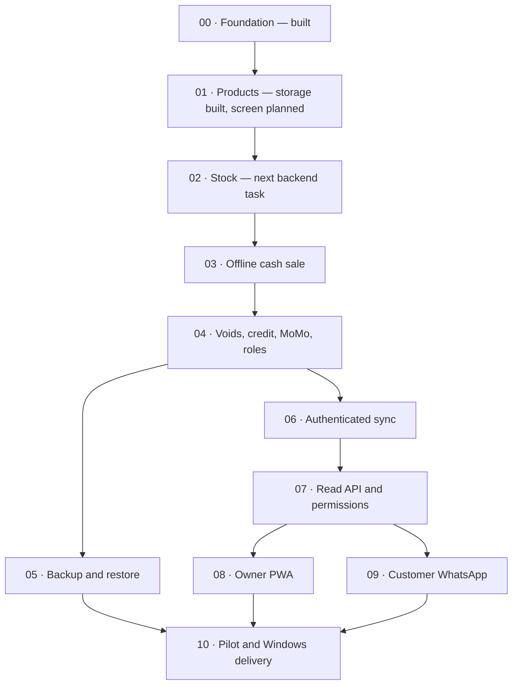

# Cella: visual delivery roadmap

> Status snapshot: 25 October 2026. Planning guide, not a new scope approval or a deadline commitment. Owners below are suggested coordination assignments; confirm availability with the team.

Open `docs/roadmap/index.html` in a browser for the interactive version. It works offline and has no external dependencies. GitHub displays the source of HTML files; download/open locally to use it.

## Delivery path

Dependency arrows describe complete user workflows. Backend stock work can begin using existing product storage while Products UI is built. The dashboard and WhatsApp integrations can run in parallel once the read API is ready.

## Immediate team objective

**Create a product → receive 10 pieces → sell 2 offline → restart → verify 8 remain and the sale still exists.**

| Person | Start now |
|---|---|
| Charles | Shell/navigation and stable application context |
| Willy | Products form and saved-products list |
| Pascal | FR/EN bundles and hands-on QA |
| Emmanuel | Stock movement/service contract and atomic sale rules |
| Patrick | Coordinate interfaces/reviews, test as a shop owner, research and missing decisions |

## Stages and acceptance checks

### 00 · Project foundation — Built

Give everyone the same working starting point.

**Suggested owners:** Patrick, Emmanuel.

**Functions:**

- Java 21 and checksum-verified Maven wrapper
- Core and desktop modules; Swing + FlatLaf
- SQLite storage and versioned database upgrades
- Linux/Windows build checks and team handoff guides

**Done when:**

- A clean checkout builds with the documented commands.
- Packaged startup and database tests pass.

**Next action:** Keep main stable and help every collaborator run the project.

**Current evidence / limits:** Foundation, SQLite and product-details changes merged; documentation PR #4 merged with successful checks. Visible Windows usability still needs human testing.

### 01 · Products you can actually manage — Partial

Enter products on screen and keep them after closing Cella.

**Suggested owners:** Charles, Willy, Pascal, Emmanuel.

**Functions:**

- Main window and Products navigation
- Name, model/reference, category and piece/kg/litre unit
- Separate buying and selling prices; buying price may be unknown
- Flexible specifications such as color and size
- Product form, saved-products list, French/English labels

**Done when:**

- Save a blue size-M T-shirt with buying price 2000 and selling price 3000 FCFA.
- Restart and see the same product and details.
- Invalid values show useful messages; saving does not freeze the window.

**Next action:** Charles builds the shell; Willy builds Products; Pascal supplies translations and tests.

**Current evidence / limits:** Product storage/schema v2 and 12 baseline tests exist. Product-entry UI, editing and deletion are not implemented. Each variant currently has a separate product ID.

### 02 · Know what is on the shelf — Next

Explain every change in stock rather than overwriting a number.

**Suggested owners:** Emmanuel, Patrick, Willy.

**Functions:**

- Receive stock and record adjustments with a reason
- Movement history per product
- Available quantity and low-stock threshold/highlight
- Quantities stored as integer thousandths for pieces, kg and litres

**Done when:**

- Receive 10 pieces; restart; 10 remain available.
- Record an adjustment and see its reason and quantity change.
- Current stock matches movement history.

**Next action:** Patrick and Emmanuel agree the stock service contract; backend implementation can begin alongside Products UI.

**Current evidence / limits:** Planned. Depends on product identity/storage; it need not wait for the entire Products screen.

### 03 · Make the first offline sale — Planned

Sell goods and reduce stock safely without internet.

**Suggested owners:** Emmanuel, Willy, Pascal, Patrick.

**Functions:**

- Product selection, cart and quantities
- Cash checkout and whole-FCFA totals
- Sale, sale items, created event and stock movement saved together
- PDF receipt baseline; optional VAT with explicit rounding rules

**Done when:**

- Start with 10 pieces, sell 2, restart: sale exists and 8 remain.
- Force a write failure: neither a partial sale nor partial stock change persists.
- PDF receipt matches the saved sale.

**Next action:** Agree service inputs/outputs and money/rounding rules before building checkout.

**Current evidence / limits:** Planned. No sales or stock services exist yet.

### 04 · Handle real shop situations — Planned

Support mistakes, credit and staff permissions.

**Suggested owners:** Emmanuel, Patrick, Willy, Charles, Pascal.

**Functions:**

- Void with reason, append-only event, compensating stock and audit record
- Customers, credit sales, debts and repayments
- Mobile Money reference with pending/confirmed state
- Login, owner/cashier roles and hashed passwords
- FR/EN messages throughout these screens

**Done when:**

- Void once restores stock; a second attempt does not restore it again.
- A 3000 FCFA debt minus a 1000 repayment leaves 2000.
- Pending MoMo is not reported as confirmed cash.
- Permission checks reject unauthorized actions in services, not only in screens.

**Next action:** Split into small PRs: voids, customers/debts, MoMo states, then role integration.

**Current evidence / limits:** Planned. Clarify partial-payment allocation and void/repayment rules with Emmanuel.

### 05 · Recover the shop’s data — Planned

Prove that lost or damaged local data can be recovered.

**Suggested owners:** Emmanuel, Charles, Pascal.

**Functions:**

- Automatic local backup
- User-selected export location, including USB
- Documented restore procedure
- Consistent SQLite backup that accounts for WAL files

**Done when:**

- Restore a backup into a separate location.
- Verify products, sales, debts and stock against the original.
- A failed backup is visible and never destroys the working database.

**Next action:** Choose and test the backup/restore procedure before real pilot data is collected.

**Current evidence / limits:** Planned. WAL recovery is not a backup; copying a live .db file alone is unsafe.

### 06 · Reconnect without losing work — Planned

Send offline records to the cloud safely, even after retries.

**Suggested owners:** Emmanuel, Patrick, Pascal.

**Functions:**

- Minimal authenticated Spring Boot sync endpoint and MySQL storage
- Append-only transactional event upload and acknowledgements
- Background client, retries and safe duplicate handling
- Sync sale creation, void and MoMo confirmation events
- Explicit catalog conflict/version rules; visible negative-stock conflict

**Done when:**

- Send the same batch twice without duplicating sales or movements.
- Make 20 sales offline and exercise 10 reconnect cycles with no loss.
- Void and MoMo status changes reach the cloud.
- Two devices selling the last item retain both sales and flag negative stock.

**Next action:** Define the event envelope, dependency ordering, acknowledgements and catalog conflict policy first.

**Current evidence / limits:** Planned. Start the minimal endpoint once the first local event format is stable; this can overlap backup work.

### 07 · Expose trustworthy cloud data — Planned

Let other interfaces read correct data with appropriate access.

**Suggested owners:** Emmanuel, Patrick, Pascal.

**Functions:**

- Products/availability, sales summaries, low stock and debts endpoints
- Owner versus customer permissions and session expiry
- Customer responses exclude buying prices, margins and debts
- Shop isolation and data freshness timestamps

**Done when:**

- Customer access to an owner endpoint is rejected.
- Different shops cannot read each other’s data.
- API summaries match synchronized source data.

**Next action:** Write endpoint examples and permission tests with the future dashboard/agent consumers.

**Current evidence / limits:** Planned. Authentication starts with the first network endpoint, not after sync is exposed.

### 08 · Give the owner a phone dashboard — Planned

Show shop health in a mobile-friendly web page.

**Suggested owners:** Patrick, Emmanuel, Pascal.

**Functions:**

- Daily/weekly sales, top products, low stock and debts
- Installable PWA with manifest and service worker
- Chart.js bundled locally
- Offline cached view with clearly stated last update

**Done when:**

- Owner views real shop data on an Android phone.
- After the first visit, the cached view opens offline and marks stale data.
- Measure the planned under-4-second load target on a documented slow-data setup.

**Next action:** Assign a dashboard implementation owner; static mockups can start early.

**Current evidence / limits:** Planned. Owner assignment is a proposal; the desktop team should not silently inherit extra modules.

### 09 · Answer customers from real stock — Planned

Answer availability and price questions from verified API data.

**Suggested owners:** Patrick, Emmanuel, Pascal.

**Functions:**

- n8n customer flow through the authorized API
- Explicit stale-data message and fallback to the owner
- Separate customer credentials with minimal access
- Owner mode is a Should item: phone allowlist plus PIN

**Done when:**

- Ask about a product and receive the same availability/price as the API.
- Unknown products produce a clear fallback rather than invented data.
- Customer conversations never expose owner-only data.

**Next action:** Start WhatsApp test-number registration early; assign the n8n/AI implementation owner.

**Current evidence / limits:** Planned. Registration, credentials and any messaging costs are external prerequisites. No messages are sent by this roadmap.

### 10 · Pilot, harden and demonstrate — Planned

Prove Cella works for a real shop and on clean Windows PCs.

**Suggested owners:** Patrick, Emmanuel, Charles, Willy, Pascal.

**Functions:**

- Real pilot-shop session and bug list
- jpackage installer with bundled Java runtime
- FR/EN completeness and Windows 10/11 checks
- Three-minute demo, backup video and second laptop
- Feature freeze followed by fixes and rehearsals

**Done when:**

- Installer works on 3 clean Windows PCs, including the planned 4 GB target.
- Pilot feedback is recorded and critical bugs resolved.
- Complete 5 clean demo rehearsals; keep fallback material ready.
- No claim of tax compliance without appropriate validation.

**Next action:** Freeze new features when Must flows are proven; prioritize fixes over extras.

**Current evidence / limits:** Planned. Installer packaging must be built/tested for Windows; Linux headless startup does not prove Windows GUI readiness.

## Work in parallel

| Track | Suggested owner | Objective |
|---|---|---|
| Competition and roles | Patrick | Confirm submission/competition dates, pre-built rules, judging criteria and permitted AI/code reuse. Fill missing roles; do not invent deadlines. |
| Shop research | Patrick + team | Interview 10 shop owners, capture the top 3 pains and secure agreement from a pilot shop. Delegate interviews while coding continues. |
| Desktop pilot | Charles / Willy / Pascal | Shell, Products UI and translations can proceed together against the shared service contract. See docs/team. |
| External access | Patrick + assigned AI owner | Register WhatsApp test number early and identify hosting/credential requirements. Store secrets securely, never in Git. |
| Quality every stage | Everyone | Small branches, reviewed PRs, passing builds, useful behavior tests and a human Windows check. Back up before database upgrades. |

## Keep extras behind Must work

### Should

- WhatsApp owner mode with allowlist + PIN
- Cash reconciliation
- Discount per sale line
- Keyboard-mode barcode scanning
- CSV product import
- Low-stock WhatsApp alert

### Could

- Printable debt statements
- ESC/POS thermal printer
- Owner-approved customer debt reminders with appropriate templates/consent

### Later

- Multi-branch and supplier orders
- Expenses, profit/loss and larger-company features
- Automatic MoMo integration; native mobile app remains out of current scope

## Release rules

- Done means demonstrated behavior, reviewed code, relevant tests and integration into main—not merely a screen or an open port.
- Customer WhatsApp is Must; owner WhatsApp is Should. Do not make owner mode a mandatory demo dependency.
- Preserve product data during migrations. Keep buying prices out of customer responses.
- No dates are assigned because competition/submission deadlines and team capacity remain unconfirmed. The original nine-week plan remains a planning reference, not an elapsed schedule.
- Update statuses/evidence after merging and validating each milestone. A chart does not automatically track GitHub.

## Sources

- [Current README](../../README.md)
- [Project master](../../SJI_INNOVA_PROJECT.md)
- [Revised v0.3 scope/event design](../../SJI_INNOVA_PROJECT_v03.md)
- [Desktop team handoff](../team/README.md)

The master and versioned plans have diverged. This roadmap uses the master for confirmed Cella/Spring Boot decisions, the revised v0.3 for event-sync and scope tiers, and the merged repository for implementation status. Other unresolved conflicts need Patrick/Emmanuel’s decision.
