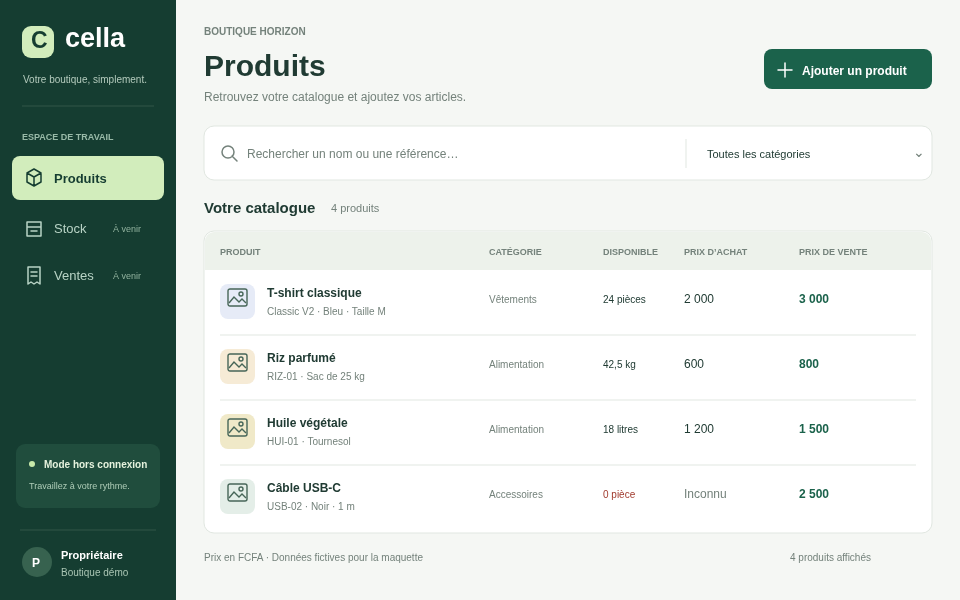
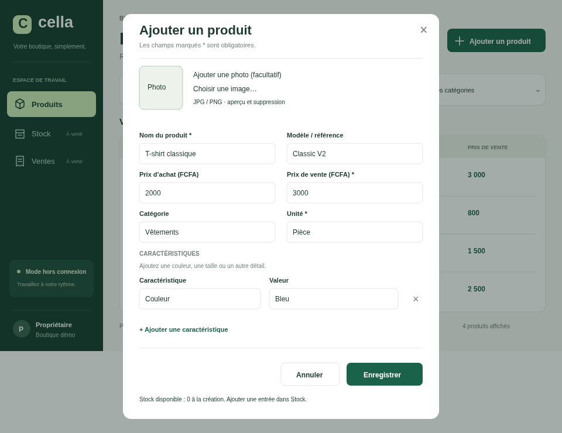

# Charles — Cella desktop design handoff

Updated 3 November 2026. This replaces your completed first shell assignment.
The shell and real Products panel are already connected on main (PR #17).
Do not recreate them or repeat the old placeholder integration task.

## Your next task

Patrick and Charles will compare visual proposals before implementing the chosen
look in Java. Prepare your proposal using the attached Products design as a
starting point. This is a proposal, not an approved final interface.

- [Products preview](../design/products.png)
- [Add product preview](../design/add-product.png)
- [Editable Products SVG](../design/cella-products.svg)
- [Editable Add product SVG](../design/cella-add-product.svg)
- [Clickable HTML prototype](../design/preview.html) — download and open locally;
  GitHub's file viewer shows source rather than running it.

## What these files mean

All products and shop details are fictitious. The HTML prototype supports search,
category filtering and adding sample products in memory; reloading resets it.
It does not connect to SQLite. No live Figma file was created: drag the SVG files
into Figma or Penpot, then check the fonts and editable layers. Imported SVGs are
not ready-made components or generated Java code.

## Visual direction

Use a calm, readable interface for a small shop: a dark green sidebar, a light
content area, a clear Products heading, search and category filter, and an obvious
Add product button. The product list shows name/model/specifications, category,
available quantity with its unit, buying price and selling price. Include an
optional photo picker, preview, replace/remove controls and a no-photo placeholder. Design the add form with labelled fields,
optional buying price, canonical units and flexible specification name/value rows.

| Element | Reference |
| --- | --- |
| Canvas for comparing proposals | 960 × 600 px |
| Sidebar | #153D31 |
| Main action | #1B624B |
| Page background | #F5F7F4 |
| Main text | #203B33 |
| Secondary text | #74827B; check contrast before implementation |
| Borders | #E1E7E1 |
| Control / dialog corners | 6–10 px / 14 px |

Use a readable sans-serif font and visible keyboard focus. Test resizing, long
names and French/English labels. Adjust colors and spacing for accessibility.
The sample owner profile is conceptual: there is no login yet. Do not display a
fake shop name, logged-in owner or unverified connectivity status in the real app.
Stock and Sales are future screens; hide them or clearly mark them unavailable.

## Steps to follow

1. Start from an up-to-date main with a clean working tree. Read README.md,
   docs/team/CONTEXT.md and the actual desktop code. Preserve unfinished work.
2. Create your own branch, e.g. design/charles-products-proposal. Open the HTML
   locally and inspect/import the SVGs. No paid Figma plan is required for using
   the local previews or SVG files.
3. Prepare a comparable Products screen and Add product dialog. Include empty,
   loading, error/retry and saving states, keyboard flow and a narrow-window view.
4. Share screenshots or exported SVGs in docs/design/charles/ and explain your
   choices. Compare with Patrick using the same sample catalog and canvas.
5. Let Patrick choose the direction before a separate Java styling PR. For this
   task, deliver design assets only; preserve current working application behavior.

## Boundaries for the later Java implementation

Keep Java 21, Swing and FlatLaf. Reuse ShellPanel, ProductsSlot, ProductPanel and
injected ProductService; coordinate ProductPanel changes with Willy and translation
keys with Pascal. Do not add a web framework or replace the desktop architecture.
No SQL/schema/core changes are needed for styling. Keep database work off the EDT,
loading readiness, disabled duplicate saves, validation, stable shop identity,
error handling, smoke mode and restart persistence. Buying price may be unknown
or exceed selling price; blank must not become zero. Do not implement product
edit/delete or make unavailable navigation look functional.

## Delivery checklist

- [ ] Products and Add product designs exported and visible in the repository.
- [ ] Loading, empty, error, saving, keyboard and resize behavior explained.
- [ ] French/English labels and whole-FCFA prices considered.
- [ ] Differences from Patrick's proposal explained in plain language.
- [ ] No fake data added to the application or live shop database.
- [ ] Branch, screenshots and remaining limitations shared with Patrick.

Design-only edits need an asset/link check, not a Java rebuild. For a later Java
change, run the wrapper clean verify and packaged smoke test from README.md;
also test the real window, save/reopen persistence and keyboard flow on Windows.
Report actual GUI checks separately from automated checks.

## Prompt to paste into your AI editor

> Read docs/team/CHARLES.md and docs/team/CONTEXT.md. Inspect the repository and
> docs/design assets. My current task is a Products and Add product visual proposal
> to compare with Patrick, not the completed shell assignment. Explain each step
> simply. Create my design exports in docs/design/charles/ and describe the UI
> states and accessibility choices. Do not change the Java implementation in this
> design task. Show what you checked and the limitations. Do not push or merge
> without my request.

## Patrick's additions: photos and available quantity

Include a thumbnail in each product row and an optional photo picker in the add
form (JPG/PNG, proposed 5 MB limit). Design missing/invalid image states, preview,
replace and remove actions. The browser prototype stores selections only in memory;
reloading loses them. Real product-photo persistence is NOT implemented. Emmanuel
must agree the product/image association, managed local files, validation, backup
and future synchronization contract before a Java photo feature is implemented.
Never depend on the original photo's absolute path on someone else's computer.

Show available quantity from the existing StockService, scoped to the current
shop/product. Product creation starts with no stock movements, so show 0; an
explicit stock receipt adds quantities. Do not add an editable balance field to
Product or write directly to stock tables. Design the subsequent Stock receipt
flow separately; do not pretend a product save also received stock. Stock loading
and errors must remain distinguishable from a genuine zero balance. Whole pieces
and fractional kg/litres must follow docs/backend/STOCK.md's integer-thousandths
rules. The displayed 24 / 42.5 / 18 / 0 quantities are fictitious mockup data.
